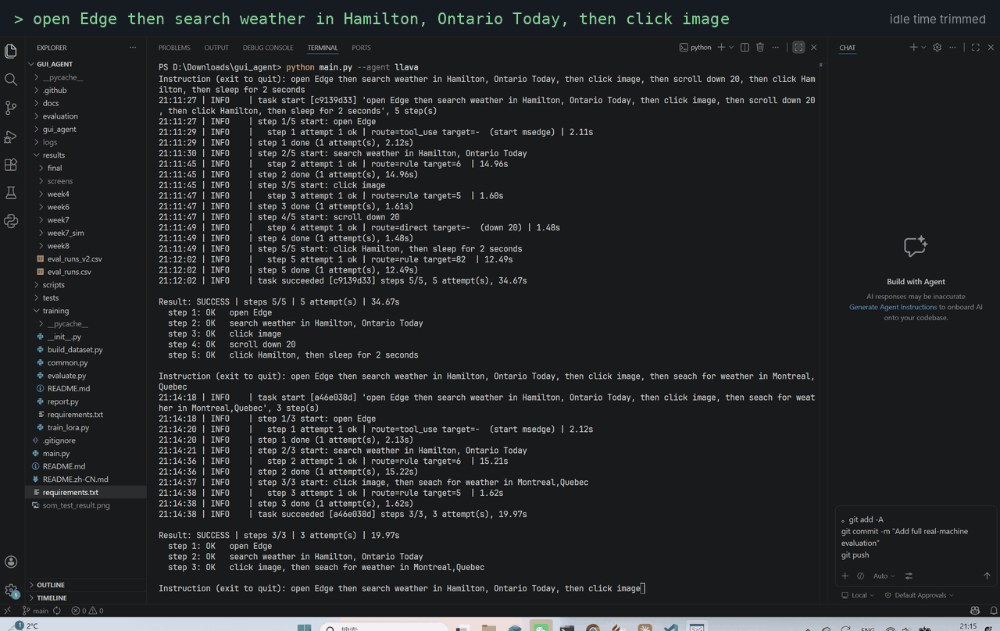
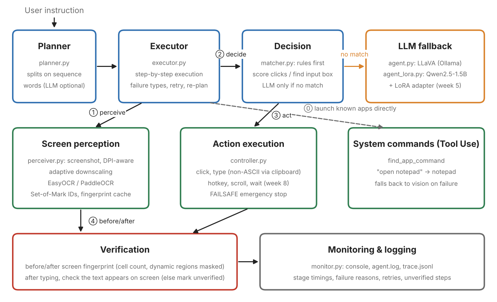
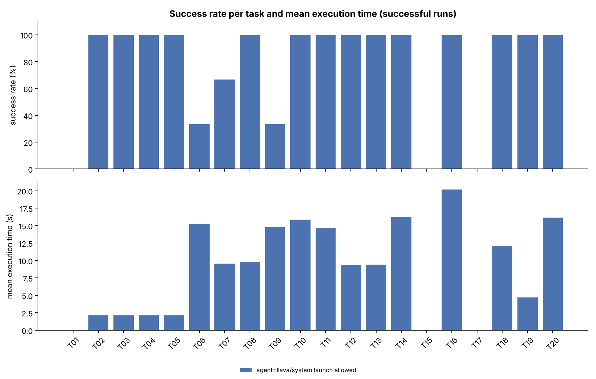

# Desktop GUI Agent

[](https://github.com/zhanz565/gui-agent/actions/workflows/tests.yml)

English | [中文](README.zh-CN.md)

**Author:** Zhenxin Zhang

A desktop GUI agent for Windows. You give it an instruction in one sentence (Chinese or English). It takes a screenshot, uses OCR to find and number the text on screen, decides where to click and what to type into which input box, drives the mouse and keyboard, and then checks whether the action actually took effect.



*Two real runs on a Windows desktop, idle waiting trimmed. First: Edge is launched with a system command, the rule matcher finds the search box and types the query, then clicks the Images tab. Second: the URL goes straight into the address bar and the page scrolls down.*

It was built as an 8-week internship project on multimodal-LLM GUI agents. The design choice that runs through it is **rules first, LLM as fallback**: common clicks and typing are matched to on-screen elements by deterministic rules, and only when the rules find no target is a vision-language model (local LLaVA, or a LoRA-fine-tuned Qwen2.5-1.5B) asked to pick an element. The model may only choose from the IDs that are actually on screen.



## Highlights

- **Two-track decision making.** A rule matcher handles intent detection (click / type / hotkey / scroll / wait), keyword scoring with exact, substring and fuzzy matching, input-box detection and payload extraction. The LLM is called only when the rules have no candidate, and its output is checked against the list of valid IDs.
- **Failure-aware execution.** The executor classifies failures into 11 types and handles each one differently: wait and rescan, ask the LLM again without the elements it already tried, switch target after repeated failures, or re-plan the remaining steps from the current screen.
- **Verification.** Each action is checked against a before/after screen signature (64×36 grayscale, cell counting, with regions that change on their own masked out). After typing, the agent rescans the screen to check the text actually appears.
- **Measured parameters.** The verification threshold, OCR downscaling limit and dynamic-region masking were chosen from experiments, not guessed (`scripts/study_*.py`).
- **Testable without a screen.** Perception, control, the LLM and app launching can all be replaced by fakes, so 71 unit tests and 26 fault-injection scenarios run on any machine, including CI.

## Results

| What | Result | Notes |
|---|---|---|
| Rule routing on the 50 fixed week-4 instructions | rules correct on **49/50** (v1: 26/50, with 24 sent to the LLM) | `python -m tests.run_routing_eval` |
| 18 adversarial instructions targeting v1's weaknesses | **18/18** (v1: 7/18) | e.g. "search chrome tutorial" must not launch Chrome |
| Fault-injection scenarios | **26/26** pass | OCR crashes, missed text, failed clicks, LLM timeouts / hallucinated IDs, emergency stop |
| 20-task simulation (ideal perception) | 19/20 with system launch, 10/20 vision only | an upper bound for the decision logic, **not** real-machine results |
| Real-machine evaluation, 20 tasks × 3 runs | **46/60 (76.7%, 95% CI 64.6–85.6%)** | 1920×1080 at 150%, LLaVA fallback, system launch allowed |

### Real-machine evaluation

All 20 tasks were run 3 times each on a 1920×1080 Windows PC (150% scaling) with LLaVA as the fallback model. Raw data: `results/eval_runs_v2.csv`; statistics, Excel and charts: `results/week7/`.

| | Runs | Success |
|---|---|---|
| L1 single step | 18 | 13 (72.2%) |
| L2 two or three steps | 24 | 21 (87.5%) |
| L3 hard | 18 | 12 (66.7%) |
| **Total** | **60** | **46 (76.7%)** |

Mean time of a successful run: 10.0 s (about 2.1 s for an app launch, 9–16 s for two or three steps).



What the numbers show:

- **The rule path is the reliable part.** Runs decided entirely by rules and system commands succeeded 42 of 48 times. Runs that needed LLaVA succeeded 4 of 12 times, and 8 of the 14 failures are `llm_invalid` (LLaVA returned an ID that was not on screen, three times in a row). This is the main argument for the rules-first design, and the reason a fine-tuned decision model (week 5) is worth finishing.
- **A bug found and fixed.** A first partial run (18 runs, `results/eval_runs.csv`) showed that `explorer.exe` returns exit code 1 even when the window opens, so "open File Explorer" was treated as a failed launch and handed to the LLM (0/3). Launch commands are now started without checking the exit code, and the screen-change check decides; T05 then passed 3/3 in 2.1 s.
- **Open issue: Notepad.** "Open Notepad" (T01) launches the app every time, but the automatic check on the final screen never finds "Notepad"/"Untitled", so it fails 0/3. Most of the 6 false positives (executor reports success, task judged not done) are Notepad tasks. The cause is still being investigated from the saved screenshots (possibly the final screen is captured before the window has finished drawing).
- **Known limits behave as expected.** T17 (typing into Notepad's blank edit area, which has no text to anchor on) fails as designed, and T15 fails at the last step because LLaVA cannot pick the "Images" tab.

The vision-only condition (`--no-launch`) has not been run on a real machine yet.

The LoRA fine-tuning pipeline (synthetic data with leakage checks, training, a five-configuration evaluation and report generation) is in `training/`. The GPU evaluation results are not included in this repository.

## Example run

Instructions are split into steps, each step logs its route (`tool_use`, `rule`, `llm`, `direct`) and target, and a failed attempt shows its failure reason. Here the first "Close" button has no effect, so the executor blacklists it and tries the next candidate:

```
task start [b4d0391a] '关闭', 1 step(s)                    # "关闭" = Close
step 1/1 start: 关闭
  step 1 attempt 1 FAILED | route=rule target=21 reason=no_screen_change
  step 1 attempt 2 ok | route=rule target=23
step 1 done (2 attempt(s))
task succeeded [b4d0391a] steps 1/1, 2 attempt(s)
```

More logs from the fault-injection scenarios are in `results/week6/sample_logs/`.

## How it works

1. **Decompose**: a long instruction such as "open Chrome then search weather then scroll down" is split into single steps.
2. **System commands**: "open Notepad / Calculator / File Explorer / Chrome / Edge" is first tried with a system command. If the screen does not change, the agent falls back to the visual path.
3. **Perceive**: take a screenshot, recognize text with EasyOCR (or PaddleOCR), and give every text block an ID together with its center coordinates (Set-of-Mark).
4. **Decide**: rules come first. Click instructions are scored against on-screen text by keyword; type instructions first look for an input box. Only when the rules find no target are the screenshot and element list passed to an LLM, which may only choose from the listed IDs.
5. **Act**: click, type (non-ASCII text is pasted through the clipboard), press keys, scroll, wait, and open a URL through the browser address bar (Ctrl+L), so "go to github.com/..." never ends up as a search-engine query.
6. **Verify**: compare the screen before and after the action. For type steps, also rescan the screen to check that the typed text appears.
7. **Retry**: handle each failure according to its cause, e.g. try the next candidate, tell the model which elements were already tried, or wait for the page to load before scanning again. Optionally, the LLM can re-plan the remaining steps.

## Requirements

- Windows 10 / 11, Python 3.10+ (adaptive downscaling reads the display scale with `GetDpiForSystem`; older systems fall back to estimating it from the screenshot size)
- No GPU needed for the rule-only path. LLaVA requires [Ollama](https://ollama.com). LoRA training needs a GPU with 8 GB+ VRAM or Colab.
- The UI language can be Chinese or English; the evaluation tasks list keywords for both.

## Installation

    pip install -r requirements.txt
    ollama pull llava                 # skip if you only use the rule path
    python scripts/check_env.py       # checks screen size, mouse movement and screenshots

Optional:

    pip install paddleocr             # to use PaddleOCR (--ocr paddle)

Training dependencies are listed separately in `training/requirements.txt`; see `training/README.md`.

## Quick start

    python main.py --dry-run          # first run: log only, no mouse or keyboard actions
    python main.py                    # normal run (LLaVA as fallback by default)
    python main.py --agent none       # rules only, no LLM

Then type instructions at the prompt, for example:

    open notepad
    open Chrome then search McMaster courses
    open Edge then search weather then click Images
    open notepad then press ctrl+s
    open Chrome then search weather then scroll down
    open Chrome then go to github.com/zhanz565/gui-agent then scroll down
    wait 3 seconds

Chinese works the same way, e.g. `打开 Chrome 然后 搜索 天气`.

Type `calibrate` to recalibrate screen regions that change on their own (videos, animations), and `exit` to quit. Moving the mouse into any corner of the screen triggers an emergency stop.

After each task the agent prints the result of every step: `OK` means success, `OK?` means the action was performed but nothing on screen confirmed it (e.g. the typed text was not found afterwards), and `FAIL` is followed by the failure reason.

## Command-line options

| Option | Default | Description |
|---|---|---|
| `--agent llava\|lora\|none` | llava | LLM used when the rules find no target; `none` disables it |
| `--adapter <path>` | outputs/lora_gui | Location of the LoRA adapter for `--agent lora` |
| `--dry-run` | off | Log only, no mouse or keyboard actions |
| `--no-launch` | off | Do not launch apps with system commands; force the visual path |
| `--max-side auto\|0\|<pixels>` | auto | Upper limit of the screenshot's long side before OCR. `auto` derives it from the display scale so that text stays at least 13 px after downscaling; `0` disables downscaling |
| `--ocr easyocr\|paddle` | easyocr | OCR engine |
| `--calibrate` | off | At startup, detect screen regions that change on their own and ignore them during verification |
| `--on-fail abort\|continue\|replan` | abort | When a step finally fails: stop / continue with the remaining steps / let the LLM re-plan from the current screen (requires a model) |
| `--no-text-check` | off | Do not rescan the screen for the typed text after typing |
| `--no-verify` | off | Do not check whether the screen changed after an action |
| `--retries N` | 3 | Maximum attempts per step |
| `--llm-timeout <seconds>` | 60 | Timeout for a single model call |
| `--llm-plan` | off | Let the LLM split long instructions the rules cannot split |
| `--log-dir` | logs | Log directory |

## Logs

- Console: INFO level, shows every step in real time.
- `logs/agent.log`: DEBUG level, rotated at 2 MB, 3 backups kept.
- `logs/trace.jsonl`: one event per line (task start, step start, each attempt, step end, task end) with per-stage timings, for analysis afterwards.
- `som_test_result.png`: the annotated image from the latest scan (a box and an ID for every text block).

## Project layout

    main.py                     command-line entry point
    gui_agent/
      perceiver.py              screenshot, DPI awareness, adaptive downscaling, OCR, numbering,
                                screen signature (with dynamic-region masking)
      matcher.py                intent detection (click/type/hotkey/scroll/wait), element scoring,
                                input-box detection, payload extraction
      planner.py                instruction decomposition; LLM-based splitting and re-planning
      executor.py               step execution, verification, cause-based retries, system-command launch
      controller.py             mouse and keyboard (click, type, hotkey, scroll), dry-run controller
      agent.py                  LLaVA (via Ollama)
      agent_lora.py             week-5 LoRA fine-tuned model, same interface as agent.py
      monitor.py                logging and task monitoring
    training/                   week 5: synthetic data, LoRA training, evaluation, report generation
    evaluation/
      tasks.py                  20 evaluation tasks + 4 extended-action tasks
      runner.py                 real-machine evaluation (environment cleanup, manual confirmation, resume)
      sim.py / run_sim.py       ideal-perception simulation
      analyze.py                statistics (Wilson intervals; by level/app/resolution/failure stage), Excel, charts
      record.py                 fields of an evaluation record
    tests/
      test_units.py             unit tests for the core modules
      test_evaluation.py        tests for the evaluation framework
      test_week8.py             tests for the week-8 features
      fakes.py                  simulated screen, perceiver, controller and model
      run_routing_eval.py       rule routing, v1 vs v2
      run_fault_injection.py    fault-injection scenarios and random-fault simulation
      legacy_router.py          v1 routing logic (for comparison)
      cases.py                  adversarial cases
      make_charts.py            the two week-6 charts
    scripts/
      check_env.py              environment check
      bench_perception.py       real-machine OCR speed, recall, and idle-screen noise check
      study_threshold.py        verification-threshold study
      study_downscale.py        downscaling-cost study (tesseract)
      study_mask.py             dynamic-region masking study
      run_demo.py               task sequence for recording the demo video
      make_final_figures.py     figures for the final report
      fetch_mind2web.py         sample Mind2Web tasks from Hugging Face
    docs/                       week 6 and 7 reports, final report, demo storyboard (in Chinese)
    results/                    experiment data and charts for each week

A note on language: comments, logs and documentation in the code are in English. Chinese text that remains in the source is functional: the keyword lists and regexes the rule matcher uses, the evaluation task instructions (with English translations in comments), simulated UI text, the LLM prompts the models were evaluated with, and the training data templates. The internship reports in `docs/` are in Chinese.

## Tests

No screen or GPU required:

    python -m unittest discover -s tests -t .       # 71 unit tests
    python -m tests.run_routing_eval                # rule-routing comparison
    python -m tests.run_fault_injection             # 26 fault scenarios + random-fault simulation

All three run on every push through GitHub Actions (`.github/workflows/tests.yml`).

## Reproducing the experiments

| Experiment | Command | Output |
|---|---|---|
| Rule-routing comparison | `python -m tests.run_routing_eval` | `results/week6/routing_eval.json` |
| Fault injection, random-fault simulation | `python -m tests.run_fault_injection` | `results/week6/fault_injection.json` |
| Verification threshold | `python -m scripts.study_threshold` | `results/week6/threshold_study.json` |
| Downscaling cost (needs tesseract) | `python -m scripts.study_downscale` | `results/week6/downscale_cost.json` |
| Dynamic-region masking | `python -m scripts.study_mask` | `results/week8/mask_study.json` |
| Simulation of the 20 tasks | `python -m evaluation.run_sim --out results/week7_sim/sim_runs.csv` | same folder |
| Extended actions, before vs after | `python -m evaluation.run_sim --ext --out results/week8/sim_ext.csv` | same folder |
| Statistics and charts | `python -m evaluation.analyze --inputs <csv...> --out <folder>` | xlsx and charts |
| Final-report figures | `python -m scripts.make_final_figures` | `results/final/` |

## Real-machine evaluation

    python -m evaluation.runner --agent llava --repeat 3 --resolution-label 1920x1080-150%
    python -m evaluation.runner --agent llava --repeat 3 --no-launch --out results/eval_vision_only.csv
    python -m evaluation.analyze --inputs results/eval_runs.csv results/eval_vision_only.csv --out results/week7

Do not touch the mouse or keyboard while the evaluation is running. The 6 tasks whose automatic check is unreliable pause for manual confirmation (`--manual all` confirms every task, `--manual none` confirms none). If interrupted, rerun the same command and recorded runs are skipped. Set `--resolution-label` to match your actual display settings; to compare resolutions, change the display settings and run again with a different label.

Before evaluating, it is worth running:

    python -m scripts.bench_perception --idle-check     # changed cells between frames on an idle screen; should be well below 3
    python -m scripts.bench_perception --repeat 5       # speed and recall under different downscaling settings

## Demo

    python -m scripts.run_demo --dry-run                # rehearsal
    python -m scripts.run_demo --agent llava            # recording

Runs 7 demo tasks in order, printing a title and a countdown before each and closing the opened apps afterwards. The storyboard is in `docs/demo_script.md`.

## Training (week 5)

    python -m training.build_dataset --out data
    python -m training.train_lora --data data --out outputs/lora_gui
    python -m training.evaluate --data data --adapter outputs/lora_gui --out results/week5
    python -m training.report --results results/week5 --train_log outputs/lora_gui/training_log.json --out report

Use the trained adapter with `python main.py --agent lora --adapter outputs/lora_gui`. See `training/README.md` for details.

## Troubleshooting

- **Clicks are offset**: usually caused by Windows display scaling. The agent enables DPI awareness at startup and converts coordinates; if clicks are still off, make sure you started it from `main.py` (DPI awareness must be set before any screenshot object is created).
- **Chinese text is not typed**: install `pyperclip`. Non-ASCII text is pasted through the clipboard, and the original clipboard content is restored afterwards.
- **Always reports "screen did not change"**: check the idle-screen noise with `--idle-check`; if the screen has videos or animations, use `--calibrate` or type `calibrate`.
- **Model fails to initialize**: make sure Ollama is running and `ollama pull llava` has been done. On failure the agent automatically falls back to the rule path.
- **Small text is not recognized**: on 2K/4K screens keep `--max-side auto` or set it to `0`; do not set it too low.

## Known limitations

- Only text is recognized. Icons, controls without text, and empty input areas (e.g. Notepad's blank editing area) cannot be located.
- Verification can show that "the screen changed" and "the typed text appeared", but not that a click hit the right target.
- Re-planning depends on an LLM and relies only on the text on screen.
- The threshold, downscaling and masking studies were run on synthetic screens; on a new machine, re-check them with the tools above.
- The LLaVA fallback is weak: it succeeded in 4 of the 12 real-machine runs that reached it.
- The real-machine evaluation covers one machine and one display setting, and the vision-only condition has not been run.
