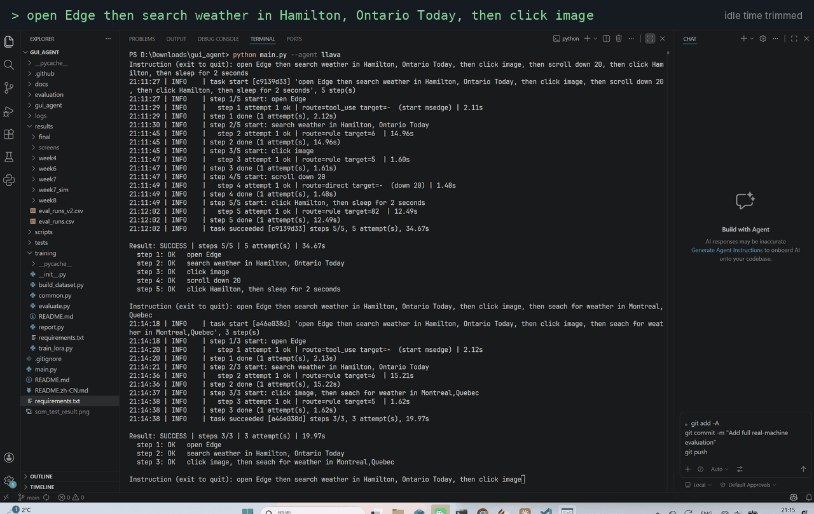
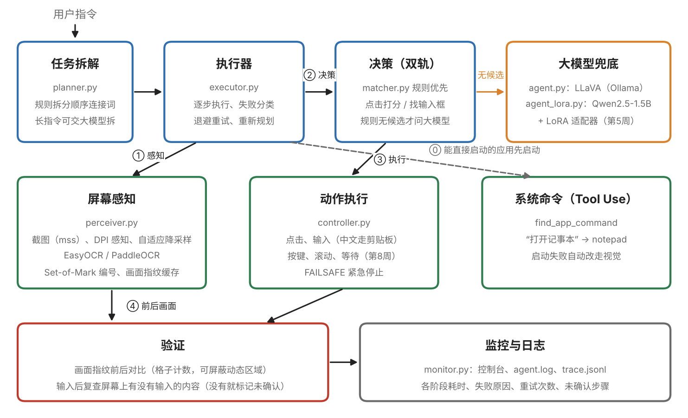

# 桌面 GUI 智能体

[English](README.md) | 中文

**作者：** Zhenxin Zhang

一个运行在 Windows 上的桌面 GUI 智能体：用一句中文（或英文）告诉它要做什么，它截取屏幕，用 OCR 找到屏幕上的文字并编号，决定点哪里、往哪个输入框输入什么，然后操作鼠标键盘，并检查操作有没有生效。

*在真实 Windows 桌面上的两次运行，等待时间已剪掉。第一段：用系统命令启动 Edge，规则找到搜索框并输入，再点击“Images”标签。第二段：网址直接输入地址栏，然后向下滚动。*

这是一个 8 周实习项目，各周的报告都在 `docs/` 目录，结项报告见 `docs/final_report.md`（Word 版：`docs/final_report.docx`）。

## 结果

| 内容 | 结果 | 说明 |
|---|---|---|
| 第 4 周固定的 50 条指令，规则路由 | 规则直接做对 **49/50**（v1：26/50，另外 24 条交给大模型） | `python -m tests.run_routing_eval` |
| 针对 v1 缺陷设计的 18 条对抗用例 | **18/18**（v1：7/18） | 例如“搜索 chrome 教程”不能被当成启动 Chrome |
| 故障注入场景 | **26/26** 通过 | OCR 崩溃、漏识、点击失败、大模型超时 / 编号幻觉、紧急停止 |
| 20 个任务的理想感知仿真 | 允许系统启动 19/20，仅视觉 10/20 | 决策逻辑的上限，**不是**真机结果 |
| 真机评估，20 个任务 × 3 轮 | **46/60（76.7%，95% 区间 64.6–85.6%）** | 1920×1080、150% 缩放，llava 兜底，允许系统启动 |

真机评估在一台 1920×1080（150% 缩放）的 Windows 电脑上把 20 个任务各跑了 3 轮，原始数据在 `results/eval_runs_v2.csv`，统计、Excel 和图在 `results/week7/`。按难度：L1 13/18，L2 21/24，L3 12/18；成功任务平均耗时 10.0 秒。

- **规则路径是可靠的部分**：完全由规则和系统命令完成的 48 轮成功 42 轮；需要 LLaVA 的 12 轮只成功 4 轮，14 次失败里有 8 次是 `llm_invalid`（LLaVA 连续给出屏幕上不存在的编号）。
- **发现并修复了一个缺陷**：第一次部分评估（18 轮，`results/eval_runs.csv`）发现 `explorer.exe` 打开窗口成功时返回码也是 1，“打开文件资源管理器”被判成启动失败（0/3）。现在启动命令不看返回码，由画面变化检查判断，修复后 T05 3/3、2.1 秒。
- **尚未解决：记事本**。“打开记事本”（T01）每次都启动成功，但最终画面的自动判定始终找不到“记事本/无标题”，0/3；6 次误报大多是记事本任务，原因还在根据截图排查。
- T17（往没有文字的空白编辑区输入）按设计预计失败；T15 卡在最后一步，LLaVA 选不中“图片”标签。

“仅视觉”条件（`--no-launch`）还没有在真机上跑。

LoRA 微调的完整流水线（带防泄漏检查的合成数据、训练、五种配置的对比评估、报告生成）在 `training/`，GPU 上的评估结果没有放进本仓库。

## 它是怎么工作的

1. **拆解**：把“打开 Chrome 然后 搜索 天气 然后 向下滚动”这样的长指令拆成单步。
2. **系统命令**：“打开记事本 / 计算器 / 资源管理器 / Chrome / Edge”优先直接用系统命令启动，启动后画面没变化就改走视觉路径。
3. **感知**：截图，用 EasyOCR（或 PaddleOCR）识别文字，每段文字编号并记下中心坐标。
4. **决策**：先用规则匹配（点击按关键词打分，输入先找输入框）；规则找不到目标，才把截图和元素列表交给大模型（本地 LLaVA，或第 5 周微调的 LoRA 模型），大模型只能从编号里选。
5. **执行**：点击、输入（中文走剪贴板粘贴）、按键、滚动、等待，以及通过浏览器地址栏（Ctrl+L）打开网址，避免“访问 github.com/...”被当成搜索词交给搜索引擎。
6. **验证**：比较操作前后的画面；输入类步骤还会复查屏幕上有没有出现输入的内容。
7. **重试**：失败时按原因处理，比如换下一个候选、告诉大模型哪些元素试过了、等页面加载完再扫描；需要时让大模型重新规划剩下的步骤。

## 环境要求

- Windows 10 / 11，Python 3.10+（自适应降采样用 `GetDpiForSystem` 读取系统缩放比例，更早的系统会退回按截图尺寸估计）
- 不需要 GPU 也能运行（只走规则路径）。用 LLaVA 需要安装 [Ollama](https://ollama.com)；LoRA 训练需要 8GB 以上显存的 GPU 或 Colab
- 界面语言为中文或英文都可以，评估任务里两种关键词都写了

## 安装

    pip install -r requirements.txt
    ollama pull llava                 # 只用规则路径可以跳过
    python scripts/check_env.py       # 检查能不能拿到屏幕尺寸、移动鼠标、截图

可选：

    pip install paddleocr             # 想用 PaddleOCR 时（--ocr paddle）

训练部分的依赖单独放在 `training/requirements.txt`，见 `training/README.md`。

## 快速开始

    python main.py --dry-run          # 第一次先试运行：只打日志，不动鼠标键盘
    python main.py                    # 正式运行（默认用 llava 兜底）
    python main.py --agent none       # 不用大模型，只走规则

启动后在命令行里输入指令，例如：

    打开记事本
    打开 Chrome 然后 搜索 McMaster 选课
    打开 Edge 然后 搜索 天气 然后 点击 图片
    打开记事本 然后 按 Ctrl+S
    打开 Chrome 然后 搜索 天气 然后 向下滚动
    打开 Chrome 然后 访问 github.com/zhanz565/gui-agent 然后 向下滚动
    等待 3 秒

输入 `校准` 会重新校准画面里自己在变化的区域（视频、动图）；输入 `exit` 退出。鼠标甩到屏幕任意一个角落可以紧急停止。

每个任务结束后会打印每一步的结果：`OK` 表示成功，`OK?` 表示动作做了但屏幕上没找到能确认它做对了的证据（例如输入后没看到输入的文字），`FAIL` 后面是失败原因。

## 命令行参数

| 参数 | 默认 | 说明 |
|---|---|---|
| `--agent llava\|lora\|none` | llava | 规则找不到目标时用哪个大模型；none 表示不用 |
| `--adapter <路径>` | outputs/lora_gui | `--agent lora` 时 LoRA 适配器的位置 |
| `--dry-run` | 关 | 只打日志，不操作鼠标键盘 |
| `--no-launch` | 关 | 不用系统命令启动应用，强制走视觉路径 |
| `--max-side auto\|0\|<像素>` | auto | OCR 前截图长边的上限。auto 按系统缩放比例计算，保证缩小后文字不低于 13 像素；0 表示不缩小 |
| `--ocr easyocr\|paddle` | easyocr | OCR 引擎 |
| `--calibrate` | 关 | 启动时校准画面里自己在变的区域，验证时跳过 |
| `--on-fail abort\|continue\|replan` | abort | 某一步最终失败后：停止 / 继续后面的步骤 / 让大模型根据当前屏幕重新规划（需要大模型） |
| `--no-text-check` | 关 | 输入后不再复查屏幕上有没有输入的内容 |
| `--no-verify` | 关 | 不检查操作前后画面有没有变化 |
| `--retries N` | 3 | 每一步最多尝试几次 |
| `--llm-timeout 秒` | 60 | 大模型单次调用超时 |
| `--llm-plan` | 关 | 规则拆不开的长指令交给大模型拆 |
| `--log-dir` | logs | 日志目录 |

## 日志

- 控制台：INFO 级别，实时看每一步。
- `logs/agent.log`：DEBUG 级别，2MB 轮转，保留 3 份。
- `logs/trace.jsonl`：每行一个事件（任务开始、步骤开始、每次尝试、步骤结束、任务结束），带各阶段耗时，适合事后用脚本统计。
- `som_test_result.png`：最近一次扫描的标注图（每段文字的框和编号）。

## 目录结构

    main.py                     命令行入口
    gui_agent/
      perceiver.py              截图、DPI 感知、自适应降采样、OCR、编号、画面指纹（含动态区域屏蔽）
      matcher.py                意图识别（点击/输入/按键/滚动/等待）、元素打分、找输入框、抽取输入内容
      planner.py                指令拆解；大模型拆分与失败后重新规划
      executor.py               逐步执行、验证、按失败原因重试、系统命令启动
      controller.py             鼠标键盘（点击、输入、按键、滚动），试运行控制器
      agent.py                  LLaVA 大模型（Ollama）
      agent_lora.py             第 5 周 LoRA 微调模型，接口和 agent.py 一样
      monitor.py                日志与任务监控
    training/                   第 5 周：合成数据、LoRA 训练、评估、生成报告
    evaluation/
      tasks.py                  20 个评估任务 + 4 个扩展动作任务
      runner.py                 真机评估（自动清理环境、人工确认、断点续跑）
      sim.py / run_sim.py       理想感知仿真
      analyze.py                统计（Wilson 区间、按难度/应用/分辨率/失败环节）、Excel、出图
      record.py                 评估记录的字段
    tests/
      test_units.py             核心模块单元测试
      test_evaluation.py        评估框架测试
      test_week8.py             第 8 周新功能测试
      fakes.py                  模拟屏幕、感知器、控制器、大模型
      run_routing_eval.py       规则路由 v1 / v2 对比
      run_fault_injection.py    故障注入场景与随机故障模拟
      legacy_router.py          v1 路由逻辑（对比用）
      cases.py                  对抗用例
      make_charts.py            第 6 周的两张图
    scripts/
      check_env.py              环境检查
      bench_perception.py       真机感知测速、召回率、静止屏幕噪声检查
      study_threshold.py        验证阈值实验
      study_downscale.py        降采样代价实验（tesseract）
      study_mask.py             动态区域屏蔽实验
      run_demo.py               录演示视频用的任务序列
      make_final_figures.py     结项报告的图
      fetch_mind2web.py         从 Hugging Face 抽取 Mind2Web 样本
    docs/                       第 6、7 周报告，结项报告，演示分镜
    results/                    各周实验数据和图

## 测试

不需要屏幕和 GPU：

    python -m unittest discover -s tests -t .       # 71 个单元测试
    python -m tests.run_routing_eval                # 规则路由对比
    python -m tests.run_fault_injection             # 26 个故障场景 + 随机故障模拟

每次 push 都会通过 GitHub Actions（`.github/workflows/tests.yml`）自动运行这三项。

## 实验复现

| 实验 | 命令 | 结果 |
|---|---|---|
| 规则路由对比 | `python -m tests.run_routing_eval` | `results/week6/routing_eval.json` |
| 故障注入、随机故障模拟 | `python -m tests.run_fault_injection` | `results/week6/fault_injection.json` |
| 验证阈值 | `python -m scripts.study_threshold` | `results/week6/threshold_study.json` |
| 降采样代价（需 tesseract） | `python -m scripts.study_downscale` | `results/week6/downscale_cost.json` |
| 动态区域屏蔽 | `python -m scripts.study_mask` | `results/week8/mask_study.json` |
| 20 个任务的仿真 | `python -m evaluation.run_sim --out results/week7_sim/sim_runs.csv` | 同目录 |
| 扩展动作仿真（前后对比） | `python -m evaluation.run_sim --ext --out results/week8/sim_ext.csv` | 同目录 |
| 统计与出图 | `python -m evaluation.analyze --inputs <csv...> --out <目录>` | xlsx 和图 |
| 结项报告的图 | `python -m scripts.make_final_figures` | `results/final/` |

## 真机评估

    python -m evaluation.runner --agent llava --repeat 3 --resolution-label 1920x1080-150%
    python -m evaluation.runner --agent llava --repeat 3 --no-launch --out results/eval_vision_only.csv
    python -m evaluation.analyze --inputs results/eval_runs.csv results/eval_vision_only.csv --out results/week7

评估过程中不要动鼠标键盘。6 个自动判定不可靠的任务会暂停等人工确认（`--manual all` 全部确认，`--manual none` 都不确认）。中断后重新运行同一条命令会跳过已经记录的轮次。`--resolution-label` 要和实际的显示设置一致；想对比分辨率，改系统显示设置后换一个标签再跑。

建议在评估之前先运行：

    python -m scripts.bench_perception --idle-check     # 静止屏幕上相邻帧变化的格子数，应明显小于 3
    python -m scripts.bench_perception --repeat 5       # 不同降采样设置下的速度和召回率

## 演示

    python -m scripts.run_demo --dry-run                # 先试一遍
    python -m scripts.run_demo --agent llava            # 正式录制

依次运行 7 个演示任务，每个任务前打印标题并倒数，结束后关掉打开的应用。分镜和录制建议见 `docs/demo_script.md`。

## 训练（第 5 周）

    python -m training.build_dataset --out data
    python -m training.train_lora --data data --out outputs/lora_gui
    python -m training.evaluate --data data --adapter outputs/lora_gui --out results/week5
    python -m training.report --results results/week5 --train_log outputs/lora_gui/training_log.json --out report

训练好的适配器用 `python main.py --agent lora --adapter outputs/lora_gui` 接入。详见 `training/README.md`。

## 常见问题

- **点击位置整体偏移**：通常是 Windows 显示缩放导致的。程序启动时会开启 DPI 感知并换算坐标；如果仍然偏，确认是从 `main.py` 启动的（DPI 感知必须在创建任何截图对象之前设置）。
- **中文输入不进去**：需要 `pip install pyperclip`，中文是通过剪贴板粘贴的，操作后会恢复原来的剪贴板内容。
- **总是报“点了画面没变”**：先用 `--idle-check` 看看静止时的屏幕噪声；画面里有视频或动图时用 `--calibrate` 或输入 `校准`。
- **大模型初始化失败**：确认 Ollama 正在运行并且已经 `ollama pull llava`；失败时程序会自动退回只走规则路径。
- **识别不到小字**：2K/4K 屏建议保持 `--max-side auto` 或改成 `0`，不要设得太小。

## 已知局限

- 只识别文字，图标、没有文字的控件、空白输入区无法定位（比如记事本的空白编辑区）。
- 验证能证明“画面变了”和“输入的内容出现了”，但不能证明点击一定点对了。
- 重新规划依赖大模型，并且只以屏幕上的文字为依据。
- 阈值、降采样、屏蔽的实验是在合成屏幕上做的，换了机器建议用上面的工具复核一次。
- LLaVA 兜底能力弱：真机上走到大模型的 12 轮只成功 4 轮。
- 真机评估只覆盖一台机器、一种显示设置，“仅视觉”条件还没跑。
