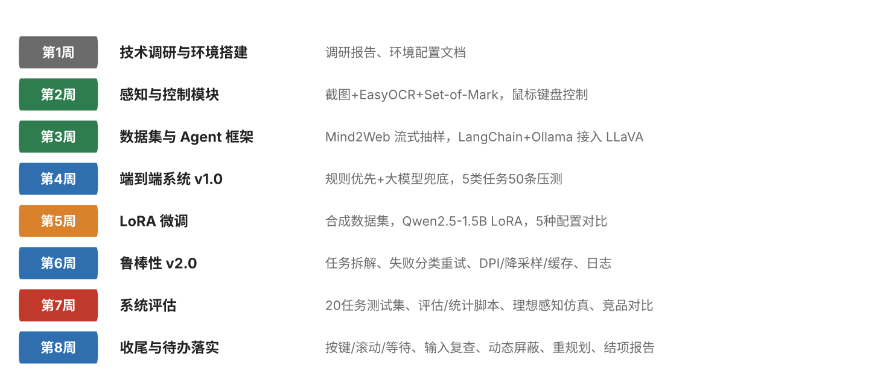
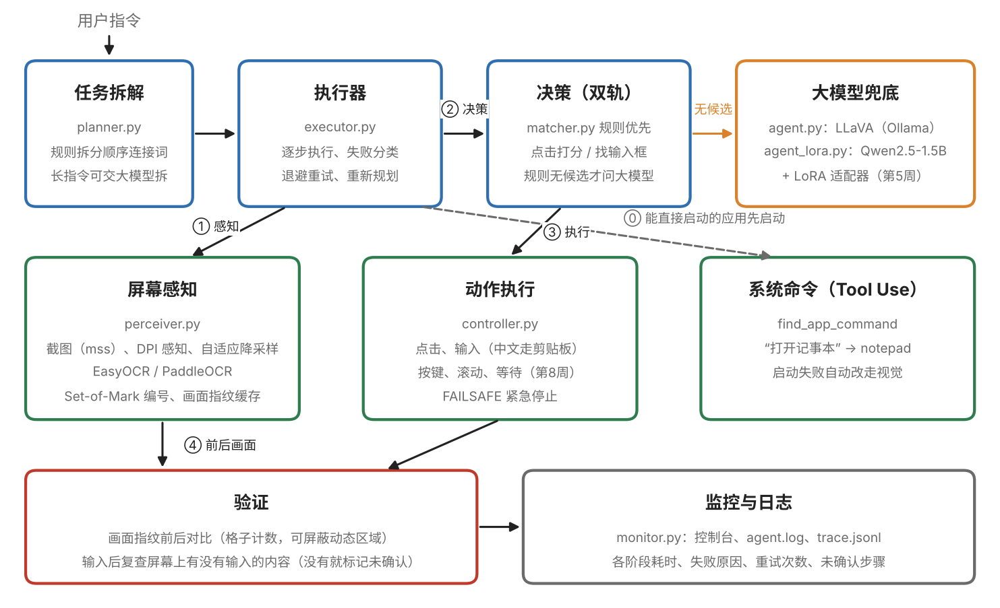
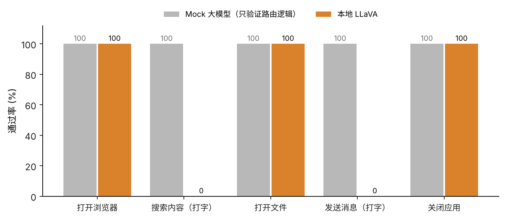
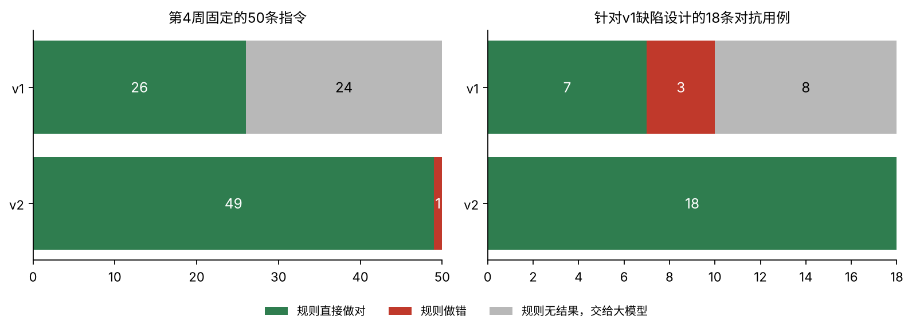
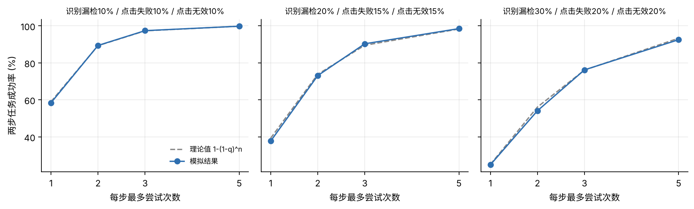
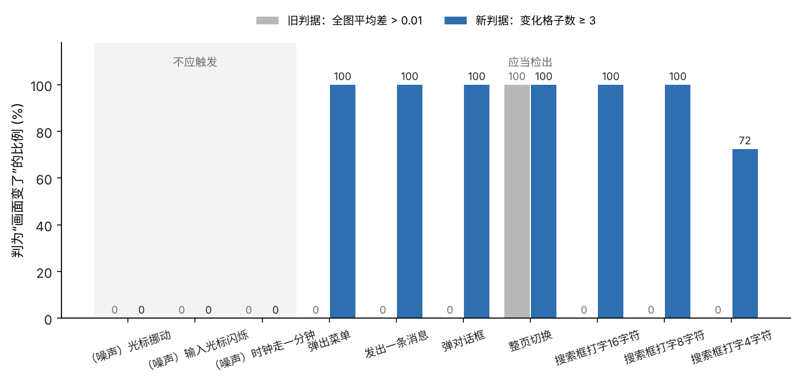
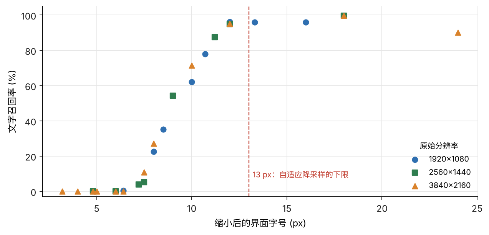
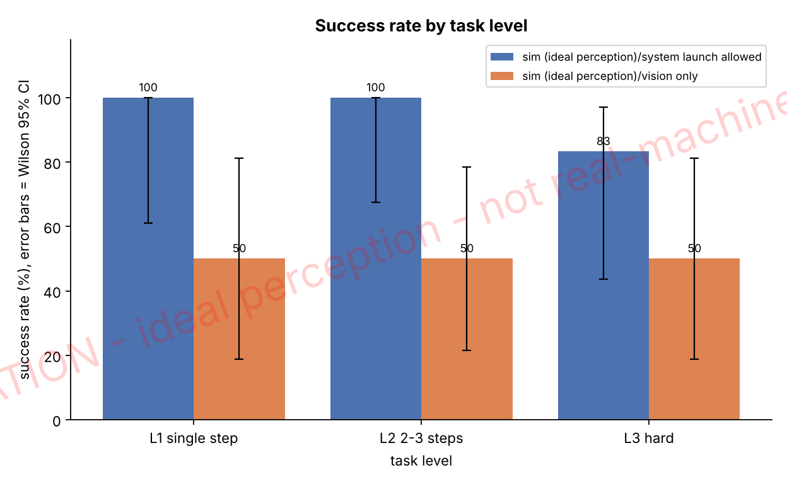
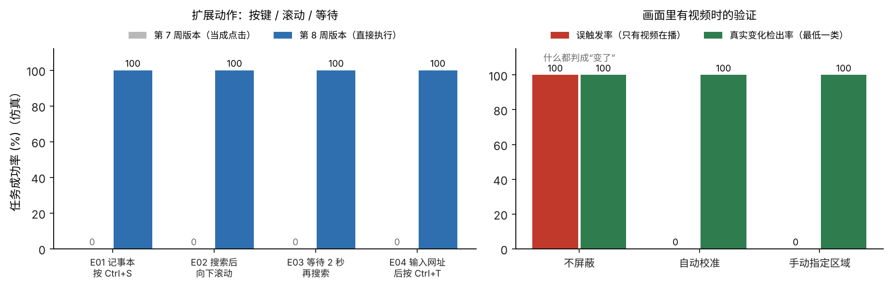

# 摘要

本项目在八周内实现了一个运行在 Windows 上的桌面 GUI 智能体原型：用户用自然语言下达指令，系统截取屏幕，用 OCR 识别屏幕上的文字并编号（Set-of-Mark），再决定点击哪个元素、往哪个输入框输入什么内容，最后通过鼠标键盘完成操作，并检查操作是否生效。

系统采用“规则优先、大模型兜底”的双轨决策：常见的点击和输入指令由规则直接匹配到屏幕元素，规则找不到目标时，才把截图和元素字典交给多模态大模型（本地部署的 LLaVA，或第 5 周用 LoRA 微调的 Qwen2.5-1.5B）。能直接用系统命令完成的步骤（例如“打开记事本”）优先走系统命令，失败后自动退回视觉路径。执行器把失败分成 11 类，按原因重试；验证环节比较操作前后的画面指纹，输入类操作还会复查屏幕上是否出现了输入的内容。

主要结果：

- 规则路由在第 4 周固定的 50 条指令上，从 v1 的 26 条直接做对、24 条需要交给大模型，提升到 v2 的 49 条直接做对、1 条做错；在 18 条针对 v1 缺陷设计的对抗用例上，从 7 对 3 错提升到 18 条全对。
- 26 个故障注入场景全部按预期处理；随机故障模拟中，重试后的成功率与理论公式的最大偏差为 2.0 个百分点。
- 验证阈值经过量化重新设计：旧判据对弹出菜单、对话框、发送消息这类局部变化的检出率为 0，新判据为 100%，且对光标移动、光标闪烁、时钟变化不误触发。
- 降采样的代价得到量化：召回率主要由缩小后的界面字号决定，低于约 13 像素后明显下降。据此把默认策略改为按系统缩放比例自适应计算。
- 在理想感知仿真中，20 个评估任务允许系统命令启动时通过 19 个，只走视觉路径时通过 10 个；第 8 周新增的按键、滚动、等待三类动作，使 4 个扩展任务从 0 个通过变为 4 个通过。
- 第 8 周把第 6、7 周报告中列出的主要局限落实为代码，共新增 28 个单元测试、6 个故障场景，全部 67 个单元测试通过。

# 1. 项目背景与目标

GUI 智能体的目标是让模型“看懂屏幕、操作电脑”，应用场景包括办公自动化（RPA）、软件测试、无障碍交互等。目前主流方案（UI-TARS、Claude Computer Use、OpenAI Operator）都由三部分组成：多模态视觉理解、大模型任务规划、桌面控制执行。

本项目的目标是在消费级硬件上，从零实现这一架构的完整闭环，并在过程中掌握多模态感知、任务规划、工具调用、模型微调和系统评估等环节。约束条件有三点：

1. 完全本地运行，不依赖云端 API，屏幕内容不出本机；
2. 能在没有 GPU 的机器上运行主流程（大模型兜底是可选的）；
3. 每个模块都能脱离真实桌面单独测试，方便定位问题。

这三点约束决定了本项目选择“OCR + 规则 + 小模型”的流水线路线，而不是 UI-TARS 那样的端到端大模型。第 6 节会对两种路线做详细对比。

# 2. 八周工作概览



| 周 | 主题 | 主要产出 |
|---|---|---|
| 1 | 技术调研与环境搭建 | GUI 智能体技术调研报告（UI-TARS、Claude Computer Use、ScreenAgent）；Python、CUDA 开发环境配置文档 |
| 2 | 感知与控制模块 | 屏幕截图、EasyOCR 文字识别、Set-of-Mark 编号与边界框绘制；基于 PyAutoGUI 的鼠标键盘控制 |
| 3 | 数据集与 Agent 框架 | Mind2Web 流式抽样与清洗脚本；基于 LangChain 与 Ollama 的 LLaVA 调用接口 |
| 4 | 端到端系统 v1.0 | “指令 → 感知 → 决策 → 执行”闭环、命令行交互；5 类基础任务共 50 条指令的压测 |
| 5 | LoRA 微调 | 合成训练集（训练 2400 / 验证 200 / 测试 300）；Qwen2.5-1.5B-Instruct 的 LoRA 微调；5 种配置的对比评估；提示词优化 |
| 6 | 鲁棒性优化 v2.0 | 复杂任务拆解、失败分类与自动重试、感知优化（DPI、降采样、缓存）、日志与监控；路由对比、故障注入、随机故障模拟 |
| 7 | 系统评估 | 20 个任务的测试集、真机评估与统计出图脚本、理想感知仿真、与 UI-TARS 和 Claude Computer Use 的对比 |
| 8 | 收尾与待办落实 | 动作空间扩展、输入复查、动态区域屏蔽、失败后重规划、自适应降采样、PaddleOCR 接入、演示脚本、结项报告、工程整理 |

# 3. 系统架构



系统由六个模块组成，代码都在 `gui_agent/` 目录下：

| 模块 | 文件 | 职责 |
|---|---|---|
| 任务拆解 | `planner.py` | 把长指令拆成单步；失败后可调用大模型重新规划剩余步骤 |
| 执行器 | `executor.py` | 逐步执行、验证、按失败原因重试；系统命令启动；记录每一步的路由和耗时 |
| 规则决策 | `matcher.py` | 意图识别（点击 / 输入 / 按键 / 滚动 / 等待）、元素打分排序、输入框识别、输入内容提取 |
| 大模型决策 | `agent.py`、`agent_lora.py` | 规则找不到目标时，根据截图和元素字典选出目标编号 |
| 屏幕感知 | `perceiver.py` | 截图、OCR、编号、坐标换算、画面指纹 |
| 动作执行 | `controller.py` | 点击、输入、按键、滚动；试运行模式 |
| 监控 | `monitor.py` | 控制台与文件日志、逐事件 trace、任务汇总 |

一条指令的处理流程如下：

1. **拆解**：`planner` 按“然后 / 接着 / 再”等顺序连接词拆分，“打开 X 搜索 Y”这类隐含两步的指令也会拆开。
2. **系统命令（可选）**：如果某一步是“打开某个应用”，并且这个应用在命令表里，就直接执行系统命令（如 `notepad`、`start chrome`），然后用画面变化确认应用确实打开了。
3. **感知**：截图、OCR，把每段文字连同中心坐标编号，生成元素字典 `{id: {text, center}}`。
4. **决策**：规则先给元素打分。点击类按关键词精确、包含、模糊三级匹配；输入类先抽取要输入的内容，再找最像输入框的元素。规则没有候选时，才调用大模型，并且只接受字典里存在的编号。
5. **执行**：点击或输入。中文输入走剪贴板粘贴，避免 `typewrite` 敲不出中文。
6. **验证**：比较操作前后的画面指纹。输入类步骤还会复查屏幕上是否出现了输入的内容。
7. **重试或继续**：失败时按原因重试，例如换下一个候选、把试过的元素告诉大模型、等页面加载完再扫描。

几个关键的设计取舍：

- **为什么规则优先**：第 4 周的压测中，本地 LLaVA 在点击类任务上表现正常，但在输入类任务上全部失败。规则匹配毫秒级完成、结果可预测，能覆盖大部分常见指令，大模型只处理规则无法覆盖的长尾情况，这样既省时间，也把模型幻觉的影响限制在小范围内。
- **为什么用 Set-of-Mark 而不是让模型直接输出坐标**：小模型直接输出坐标的定位能力有限，而“从编号中选一个”把定位问题变成了选择题，再由代码把编号换算成坐标。另外，代码会校验编号是否合法，模型给出不存在的编号时可以直接拦截。
- **为什么要有系统命令路径**：“打开应用”在视觉路径上依赖桌面上有这个应用的图标，第 7 周的仿真证明这一点会让很多任务失败，而系统命令不依赖屏幕状态。这相当于把最常见、最确定的一类动作交给工具调用（Tool Use）。

# 4. 关键实现细节

## 4.1 屏幕感知

**截图与坐标系。** 截图使用 mss，只截主屏幕。Windows 的显示缩放为 125% 或 150% 时，如果进程没有声明 DPI 感知，截图的像素坐标和 PyAutoGUI 的鼠标坐标不在同一个坐标系，点击会整体偏移。v2 在程序启动、创建任何截图和鼠标对象之前调用 `SetProcessDpiAwareness(2)`，并用“截图尺寸 ÷ 逻辑屏幕尺寸”的比例把 OCR 坐标换算回鼠标坐标。这部分换算有单元测试覆盖（3840×2160 截图对应 2560×1440 逻辑屏幕时，中心点应换算为 (1280, 720)）。

**OCR 与编号。** 默认使用 EasyOCR（中英文），过滤掉置信度低于 0.3 和内容为空的结果后，按顺序重新编号，保证编号连续，然后在截图上画出边界框和编号。第 8 周增加了 PaddleOCR 作为可选引擎（`--ocr paddle`），把 PaddleOCR 2.x 和 3.x 两种输出格式统一转换为 EasyOCR 的格式，下游代码不需要改动。

**降采样。** 高分辨率截图直接送进 OCR 很慢，所以 OCR 之前会把长边缩小。第 6 周量化了降采样的代价（见 5.5 节）：召回率主要由缩小后的界面字号决定，低于约 13 像素后明显下降。第 8 周据此把默认值从固定的 1600 改为自适应：

- 先读取系统缩放比例（`GetDpiForSystem() / 96`），估计界面字号约为 12 像素乘以缩放比例；
- 要求缩小后的字号不低于 13 像素，即缩放系数不小于 13 ÷ 界面字号；
- 100% 缩放时界面字号只有 12 像素，本来就低于 13，因此不缩小。

按这个规则，1920×1080 @125% 的长边上限是 1664，2560×1440 @150% 是 1849，3840×2160 @150% 是 2774，3840×2160 @200% 是 2080。用户仍然可以用 `--max-side` 指定固定值。

**缓存与画面指纹。** 每次扫描先把截图缩成 64×36 的灰度图作为指纹。如果和上一次扫描相比画面没有变化，就直接复用上次的 OCR 结果。每次点击、输入之后都会主动让缓存失效，保证下一次扫描是新的结果。

## 4.2 指令理解与规则匹配

**意图识别。** 先判断指令属于哪一类：

| 意图 | 例子 | 处理方式 |
|---|---|---|
| 按键 | 按 Ctrl+S、按下回车键、press ctrl + c | 直接执行，不找目标 |
| 滚动 | 向下滚动 3 次、滚动到底部 | 在屏幕中央滚动，不找目标 |
| 等待 | 等待 2 秒、稍等 | 直接等待（上限 30 秒） |
| 输入 | 搜索 天气、在聊天框发送 你好、输入网址 www.baidu.com | 抽取输入内容，找输入框 |
| 点击 | 点击 文件、打开 Google Chrome | 给元素打分排序 |

按键、滚动、等待是第 8 周新增的。它们必须在其他判断之前识别，否则“按下 回车”会被当成点击一个叫“回车”的按钮。同时，只有所有词都是合法键名时才算按键，“按下 搜索按钮”仍然是点击。

**点击匹配。** 先去掉开头的动词（点击、打开、进入……），再分两档去掉噪声词：第一档只去掉“按钮、图标、链接”这类明显不属于目标名称的词，匹配不到时再去掉“浏览器、屏幕右上角的”等。英文词按单词边界删除，避免 “weather” 里的 “the” 被删掉。然后依次进行精确匹配、包含匹配和模糊匹配（容忍 OCR 的个别错字），返回按分数排序的候选列表，而不是单个结果，重试时可以换下一个。

**输入匹配。** v1 对所有指令都先做点击匹配，屏幕上恰好有含“天气”的文字时，“搜索 天气”会被当成点击。v2 先判断意图，输入类指令用规则抽取要输入的内容，再根据指令类别（搜索 / 聊天 / 通用）给元素打分，挑出最像输入框的元素，例如包含“搜索”“网址”“输入消息”等提示文字、以省略号结尾的占位符。像“搜索”这种不超过 3 个字的短词更像按钮，会被扣分。

**系统命令的拦截。** v1 用 `"chrome" in instruction` 判断是否要启动 Chrome，“搜索 chrome 教程”也会被当成启动指令。v2 要求意图必须是点击，并且清洗后的关键词恰好是应用名，才会走系统命令。评估集中的 T20（“打开 Edge 浏览器 搜索 Edge 浏览器使用教程”）就是专门测试这一点的。

## 4.3 任务拆解与重新规划

规则拆解只在顺序连接词后面紧跟动作动词时才拆，避免把“发送 我们再见”中的“再”误拆开。顿号和逗号不拆，因为“点击输入聊天信息框，打字说 下周赛道见”本来就是一步。第 8 周把按键、滚动、等待也加入了动词表，“打开 Chrome 然后 搜索 天气 然后 向下滚动”会被正确拆成三步。

规则只拆出一步、指令又较长时，可以选择让大模型拆分（`--llm-plan`），大模型返回的结果不合格时退回规则结果。

第 8 周新增了失败后重新规划（`--on-fail replan`）：某一步最终失败时，把原指令、已完成的步骤、失败的步骤、失败原因和当前屏幕上的文字交给大模型，让它给出剩余步骤。为了防止循环，每个任务最多重新规划一次；返回结果不是字符串列表、为空或者超过 8 步时一律丢弃，按停止处理。重新规划成功时，任务是否成功只看新计划中的步骤。

## 4.4 执行、验证与重试

**失败分类。** 执行器把一次尝试的失败归为以下几类，重试时针对原因处理：

| 失败原因 | 含义 | 重试时的处理 |
|---|---|---|
| perception_error / no_elements | 截图或 OCR 出错 / 没识别到文字 | 退避等待后重新扫描（页面可能还在加载） |
| no_candidate | 规则没有候选，也没有大模型 | 重新扫描后再匹配 |
| llm_no_output / llm_invalid / llm_timeout | 大模型无输出 / 给出不存在的编号 / 超时 | 再问一次，已试过的元素从字典中去掉并在提示中说明 |
| action_failed | 控制器返回失败（越界、异常） | 同一目标再试，连续两次失败就换目标 |
| no_screen_change | 点击后画面没变 | 目标加入黑名单，换下一个候选；候选用完后清空黑名单 |
| budget_exceeded / skipped | 超过任务时间预算 / 前一步失败后跳过 | 不重试 |

默认每步最多尝试 3 次，退避时间为 0.5、1、2 秒。鼠标甩到屏幕角落触发的 `FailSafeException` 会一路抛出，不会被当成普通失败重试。大模型调用放在线程池里执行并设置超时，超时后换一个新的线程池，避免后续调用排在卡住的线程后面。

**画面变化验证。** 最初的判据是“两张指纹的平均灰度差大于 0.01”。第 6 周量化后发现，弹出菜单只占画面 4% 左右，平均差只有 0.001 量级，会被判成“点了没反应”。新判据统计灰度差超过 `cell_delta`（6 个灰度级）的格子数，达到 `min_cells`（3 个）才算画面变了。两个参数的选取方法和实验结果见 5.4 节。

**动态区域屏蔽（第 8 周）。** 画面中有视频、动图、滚动字幕时，“画面变了”永远成立，验证会失效。第 8 周增加了两种屏蔽方式：

- `calibrate()`：屏幕静止时连续取 8 帧指纹，找出自己在变化的格子，向外扩一格（动态内容的边缘在相邻格子里也会抖动），之后比较时跳过这些格子。启动时加 `--calibrate`，或运行中输入“校准”即可。
- `ignore_regions`：手动指定要忽略的区域（相对坐标），例如任务栏右下角的时钟。

**输入复查（第 8 周）。** “画面变了”不等于“做对了”。输入类步骤在画面变化之后，会再扫描一次屏幕，检查输入的内容是否出现（允许 OCR 错一两个字的模糊匹配）。如果没出现，步骤会被标记为“未确认”（unverified），但不会重试，因为重试会导致重复输入。按键和滚动之后画面没变化时，也只标记为未确认、不重试，避免 Ctrl+V 这类按键被执行两次。未确认步骤的数量会写入任务汇总和评估记录，用于衡量“执行器报告成功、实际没做成”的误报。

## 4.5 大模型决策

**LLaVA（第 3、4 周）。** 通过 LangChain 的 ChatOllama 调用本地 LLaVA，把带编号标注的截图和元素字典一起交给模型，要求它输出 `{"action", "target_id", "text"}` 格式的 JSON。为了减少幻觉，只把长度小于 30 个字符的元素放进字典（更长的通常是段落或日志），并在提示中列出合法编号。执行前代码会再次检查编号是否在字典中。

**LoRA 微调（第 5 周）。** Mind2Web 的抽样数据只有指令和动作数量，没有屏幕元素和目标标注，无法直接监督“元素字典 + 指令 → 动作”的映射。因此按照 `perceiver` 的输出格式合成了训练数据（训练 2400、验证 200、测试 300），并加了防泄漏断言，保证测试指令与训练集零重叠。另外，第 4 周的 50 条指令被固定为 hard50 评测集。

基座选用 Qwen2.5-1.5B-Instruct，做纯文本 LoRA：决策所需的信息主要来自 OCR 元素字典，截图在这一步是冗余的，纯文本模型训练和推理都更便宜，也更容易做对比。超参数为 r=16、alpha=32、dropout=0.05，学习率 2e-4，训练 3 个 epoch，等效批大小 16，最大长度 1536，支持 4bit QLoRA 和断点续训。微调后的适配器通过 `--agent lora --adapter <路径>` 接入主程序，接口与 LLaVA 版本一致。

评估对比了五种配置：基座 + 原提示词（第 4 周旧调用方式，不传合法编号）、基座 + 原提示词（传合法编号）、基座 + 优化提示词、LoRA + 微调提示词、LoRA + 优化提示词。评估指标包括 JSON 合法率、动作准确率、目标编号准确率、编号幻觉率、输入文本准确率和完全正确率。评估脚本见 5.2 节。

## 4.6 监控与日志

日志分三层：控制台输出 INFO 级别；`logs/agent.log` 记录 DEBUG 级别（2MB 轮转，保留 3 份）；`logs/trace.jsonl` 每行一个结构化事件（任务开始、步骤开始、每次尝试、步骤结束、任务结束），带各阶段耗时，可以事后用脚本统计。每个任务结束后输出汇总，包括步骤数、尝试次数、重试次数、总耗时、各阶段耗时、失败原因分布、未确认步骤数和重新规划次数。日志中不使用 emoji，避免 Windows GBK 控制台报编码错误。

# 5. 实验与结果

## 5.1 第 4 周：基础任务压测

第 4 周对 5 类基础任务各设计 10 条不同说法的指令，共 50 条，在手写的元素字典上测试决策是否正确。



用 Mock 大模型隔离时，路由逻辑全部正确；换成本地 LLaVA 后，点击类任务（打开浏览器、打开文件、关闭应用）全部通过，输入类任务（搜索内容、发送消息）全部失败。当时记录的原因是模型幻觉；第 5 周排查时还发现，第 4 周的测试脚本调用大模型时没有传入合法编号列表，提示词里写成了“无合法 ID 可用”，与主程序的实际调用方式不一致，这也是原因之一，第 5 周的评估专门加了一组配置复现旧的调用方式。这一结果直接决定了后面两周的方向：第 5 周用微调提升模型在输入类任务上的能力，第 6 周用规则直接解决输入框识别和输入内容抽取。

## 5.2 第 5 周：LoRA 微调效果

训练数据生成（含防泄漏检查）、LoRA 训练、五种配置的对比评估和报告生成脚本都已完成，并用 mock 后端跑通了整条流水线（`python -m training.evaluate --backend mock`）。GPU 上的正式评估结果没有保存在本仓库中，这里不列数字；复现命令见第 10 节，结果会写到 `results/week5/summary.json`，`training.report` 会据此生成对比表和图。

需要说明的是，test 集是合成分布，hard50 的元素字典是手写的模拟数据，这两个数字反映的是“在元素字典上做决策”的能力，不是真实屏幕上的端到端成功率。

## 5.3 第 6 周：规则路由与容错

**规则路由对比。** 在第 4 周固定的 50 条指令上对比 v1 和 v2 的规则路由：



v1 有 24 条指令规则匹配不到，只能交给大模型；v2 中 49 条由规则直接做对，只有 1 条做错，即“在输入框打字”。这条指令本身没有给出输入内容，属于有歧义的写法。在 18 条针对 v1 缺陷设计的对抗用例上（例如“搜索 天气”在屏幕上有“天气”二字时被误当成点击，“搜索 chrome 教程”被误当成启动 Chrome），v1 做对 7 条、做错 3 条、交给大模型 8 条，v2 全部做对。需要注意的是，对抗用例是在分析 v1 之后设计的，对 v2 有利，只能说明这些已知缺陷被修复了。

**故障注入。** 用模拟的屏幕状态机、感知器和控制器构造了 26 个故障场景，覆盖感知异常、目标漏识、点击失败、点击无效、同名元素、坐标越界、大模型给出非法编号、大模型超时、大模型异常、时间预算耗尽、系统命令失败后降级、紧急停止，以及第 8 周新增的按键、滚动、输入复查和重新规划，全部按预期处理。

**随机故障模拟。** 对两步任务（“点击 Google Chrome 然后 搜索 McMaster 选课”）随机注入三种故障：识别漏检（概率 p_m）、点击失败（p_f）、点击无效（p_n），每次尝试独立抽取。设每步最多尝试 n 次，一次尝试成功的概率为：第 1 步 q₁ = (1 − p_m)(1 − p_f)(1 − p_n)，第 2 步（输入，没有“点击无效”）q₂ = (1 − p_m)(1 − p_f)。任务成功率为

P = [1 − (1 − q₁)ⁿ] · [1 − (1 − q₂)ⁿ]

平均尝试次数为 E = P₁/q₁ + P₁ · P₂/q₂，其中 Pᵢ = 1 − (1 − qᵢ)ⁿ。



每组配置跑 3000 次。12 组配置中，模拟结果与公式的最大偏差为 2.0 个百分点（z = −2.14），平均尝试次数的最大偏差为 0.08。以三种故障分别为 20%、15%、15% 为例，每步最多尝试次数从 1 次增加到 3 次，按公式成功率从 39.3% 提升到 89.5%（模拟结果为 37.7% 和 90.3%），平均尝试次数从 1.58 增加到 2.92；再增加到 5 次，成功率只多 8.8 个百分点，所以默认取 3 次。这组模拟的故障概率是人为设定的，而且假设各次尝试相互独立，真实环境中故障往往是连续的（例如页面没加载完，连续几次都识别不到），因此不能把它当作真机成功率。

## 5.4 验证阈值的选取

在 1920×1080 的合成桌面上做两类改动，每种随机位置或内容重复 200 次，比较新旧两种判据：



噪声类（光标移动、输入光标闪烁、时钟变化）在两种判据下都不会误触发。但旧判据只能检出整页切换，对弹出菜单、对话框、发送消息、搜索框打字的检出率都是 0。

新判据的参数选取规则是：对每个 `cell_delta`（试了 6、12、24），先取噪声类变化格数的最大值，`min_cells` 取这个最大值加 1，保证噪声不误触发；再比较各组合在变化类上的检出率。`cell_delta = 6` 时噪声最多变化 2 格，`min_cells = 3`，这时除了“搜索框只打 4 个字符”（检出率 72.5%）以外，其余变化全部检出。`cell_delta = 12` 时，打 8 个字符的检出率只有 90%；`cell_delta = 24` 时，弹出菜单的检出率只有 34%，因为菜单与背景的对比度不高。

这个选择的余量只有 1 格。真实屏幕上的噪声可能更大，所以提供了 `python -m scripts.bench_perception --idle-check` 命令，在静止屏幕上检查相邻两帧的变化格数。少于约 8 个字符的输入，其画面变化与光标噪声在同一量级；不过输入类步骤默认会按回车，回车通常会触发跳转或发出消息，变化量要大得多。第 8 周加入的输入复查也正好弥补这一点。

## 5.5 降采样的代价

把 1920×1080、2560×1440、3840×2160 三种分辨率的合成屏幕（Noto Sans CJK 渲染的中英文界面词）按不同的长边上限缩小后识别，统计召回率：



召回率主要由缩小后的界面字号决定，与原始分辨率关系不大：字号不小于 13 像素时召回率在 96% 以上，11 像素左右为 78% 至 88%，10 像素左右为 62% 至 71%，8 像素约为 23% 至 27%，7.5 像素及以下基本低于 11%。

降采样的收益是检测网络的计算量与像素数成正比，缩放系数为 s 时像素数变为 s²，例如 4K 屏缩到 1600 时只剩 17%。缩放本身的耗时为 1 至 24 毫秒，可以忽略。坐标的量化误差最大为 0.5/s 像素（4K 缩到 1024 时也只有 1.9 像素），远小于按钮尺寸。因此降采样的代价不在于“点偏”，而在于“漏识”。

这组实验使用 tesseract 作为 OCR 引擎。它对小字的鲁棒性一般比 EasyOCR 差，所以 13 像素这个门槛是偏保守的参考值，EasyOCR 的实际数据可以用 `scripts/bench_perception.py` 在真机上测量。第 8 周的自适应降采样就是以这个门槛为依据设计的。

## 5.6 第 7 周：系统评估

**测试集。** 共 20 个任务，分三档难度：L1 单步 6 个、L2 两三步 8 个、L3 困难 6 个，涉及记事本、计算器、文件资源管理器、Chrome、Edge 五个应用。L3 中有两个落在系统能力边界上的任务：T17（往记事本空白编辑区输入，那里没有任何文字可以作为输入框的依据）和 T18（点击计算器上的单个数字，OCR 对单字符不稳定）。成功判定是最终画面 OCR 结果中是否出现预期关键词；有 6 个任务的自动判定不可靠，由人工确认。

**指标。** 任务成功率（附 Wilson 95% 置信区间）、成功任务的平均执行时间、错误率及失败环节（感知 / 决策 / 执行 / 验证 / 其他）、重试率、误报与漏报。

**理想感知仿真。** 把 20 个任务放进模拟的 Windows 桌面，用真实的规划、匹配和执行代码运行，OCR 视为全部正确、点击不会失败，用来确定决策逻辑本身的上限。



| 条件 | 通过 | 成功率 | 95% 区间 |
|---|---|---|---|
| 允许系统命令启动应用 | 19 / 20 | 95% | 76.4% – 99.1% |
| 只走视觉路径 | 10 / 20 | 50% | 29.9% – 70.1% |

允许系统命令时，唯一的失败是 T17：空白编辑区没有文字，规则找不到输入框。只走视觉路径时，失败的 10 个任务中，除 T17 外，其余 9 个都是因为模拟桌面上没有记事本、计算器、资源管理器的图标。这说明视觉路径能否完成任务取决于目标是否出现在屏幕上，也说明保留系统命令路径是必要的。

**真机评估。** 在一台 1920×1080、150% 缩放的 Windows 电脑上运行 `evaluation.runner`（llava 兜底，允许系统命令启动），20 个任务各 3 轮，共 60 轮。原始记录在 `results/eval_runs_v2.csv`，统计、Excel 和图在 `results/week7/`。6 个自动判定不可靠的任务由人工确认，17 次人工确认中有 4 次推翻了自动判定。

| 难度 | 轮数 | 成功 | 成功率 |
|---|---|---|---|
| L1 单步 | 18 | 13 | 72.2% |
| L2 两三步 | 24 | 21 | 87.5% |
| L3 困难 | 18 | 12 | 66.7% |
| 合计 | 60 | 46 | 76.7%（95% 区间 64.6%–85.6%） |

成功任务平均耗时 10.0 s：系统命令启动应用约 2.1 s，两三步的任务 9–16 s。重试率 15%，误报（执行器报告成功但任务没完成）6 次，漏报 1 次。

几点观察：

1. **规则路径是可靠的部分。** 完全由规则和系统命令完成的 48 轮成功 42 轮；需要 LLaVA 的 12 轮只成功 4 轮。14 次失败中有 8 次是 `llm_invalid`，即 LLaVA 连续三次给出屏幕上不存在的编号。这从真机数据上支持了“规则优先、大模型兜底”的设计，也说明第 5 周微调决策模型的方向值得继续。
2. **评估发现并修复了一个缺陷。** 第一次部分评估（18 轮，`results/eval_runs.csv`）中“打开文件资源管理器”0/3：`explorer.exe` 打开窗口成功时返回码也是 1，执行器把它判成启动失败，交给大模型在桌面上乱点。修复后启动命令不看返回码，由随后的画面变化检查判断（`executor.default_launcher`），T05 变为 3/3、2.1 s。
3. **记事本的判定问题尚未解决。** T01“打开记事本”每次都启动成功，但最终画面的自动判定始终没有找到“记事本/无标题/Notepad/Untitled”，0/3；6 次误报里大多数是记事本相关任务。初步推测是最终画面截取时记事本窗口还没有绘制完成，需要结合保存的截图确认。
4. **已知局限的表现符合预期。** T17（往没有文字的空白编辑区输入）按设计预计失败；T15 卡在最后一步，LLaVA 选不中搜索结果页的“图片”标签；T09 有两轮规则没找到 Chrome 的搜索框，转交 LLaVA 后失败。
5. 和 20 个任务的理想感知仿真（允许系统启动 19/20）相比，真机上的差距主要来自 OCR 结果与预设界面文字的差异和 LLaVA 的不稳定。

“仅视觉”条件（`--no-launch`）以及其他分辨率还没有在真机上跑。

## 5.7 第 8 周：新增功能验证



**扩展动作。** 设计了 4 个需要按键、滚动或等待的扩展任务，在同一个仿真环境中对比第 7 周版本（这些指令会被当成点击）和第 8 周版本：

| 任务 | 指令 | 第 7 周版本 | 第 8 周版本 |
|---|---|---|---|
| E01 | 打开记事本 然后 按 Ctrl+S | 失败（no_candidate） | 成功 |
| E02 | 打开 Chrome 然后 搜索 天气 然后 向下滚动 | 失败（no_candidate） | 成功 |
| E03 | 打开 Edge 然后 等待 2 秒 然后 搜索 Python 教程 | 失败（no_candidate） | 成功 |
| E04 | 打开 Chrome 然后 输入网址 www.wikipedia.org 然后 按 Ctrl+T | 失败（no_candidate） | 成功 |

原来的 20 个任务在第 8 周版本上的仿真结果不变（19/20 和 10/20），说明新增功能没有影响已有任务。

**动态区域屏蔽。** 在合成桌面上放一块 320×180 的“视频”区域，每帧内容变化，重复 100 次：

| 做法 | 屏蔽的格子 | 误触发率（只有视频在播） | 真实变化检出率（菜单、对话框、消息） |
|---|---|---|---|
| 不屏蔽 | 0 | 100% | 无意义（所有情况都判为“变了”） |
| 自动校准 | 117 格（5.1%） | 0% | 100% |
| 手动指定区域 | 77 格（3.3%） | 0% | 100% |

自动校准比视频区域多屏蔽了一圈，这是向外扩一格造成的，换来的好处是对视频边缘的抖动更稳健。

**测试规模。** 第 8 周新增 28 个单元测试（意图解析、控制器、直接动作、输入复查、重新规划、屏蔽、自适应降采样、PaddleOCR 格式转换、扩展任务仿真）和 6 个故障场景，全部单元测试共 67 个，全部通过；第 6 周的路由对比和随机故障模拟结果在第 8 周代码上可以完全复现。

# 6. 与 UI-TARS、Claude Computer Use 的对比

| 维度 | 本项目 | UI-TARS | Claude Computer Use |
|---|---|---|---|
| 路线 | 流水线：OCR + 规则 + 大模型兜底 | 端到端视觉语言模型 | 通用多模态大模型 + computer 工具 |
| 感知 | 只识别文字，看不到图标和无文字控件 | 直接看像素 | 直接看截图 |
| 定位 | OCR 框中心；大模型只从编号中选 | 模型输出坐标 | 模型输出坐标，可放大局部 |
| 决策 | 规则优先，小模型兜底；失败后可重新规划 | 每步先推理（分解、里程碑、反思）再输出动作 | 通用大模型逐步推理 |
| 动作 | 点击、输入、按键、滚动、等待 | 点击、拖拽、滚动、输入、结束、求助等 | 点击、拖拽、滚动、按键、等待、放大等 |
| 纠错 | 按失败原因重试；画面变化 + 输入复查 | 训练中使用反思与纠错数据 | 模型看新截图自行判断 |
| 运行 | 完全本地、离线 | 开源权重，可本地部署 | 云端 API |

公开基准数据（不同来源、不同版本的基准不能直接横向比较，本项目没有在这些基准上测试）：UI-TARS 论文报告 OSWorld（50 步）24.6、ScreenSpot-Pro 38.1（72B）；UI-TARS-1.5 模型卡报告 OSWorld（100 步）42.5、ScreenSpot-Pro 61.6；UI-TARS-2 报告 OSWorld 47.5、WindowsAgentArena 50.6。Claude 系列在 OSWorld-Verified 上的成绩据第三方汇总，从 2025 年 9 月的 61.4% 提升到 2026 年 4 月的 78.0%，人类基线约 72.4%。

差距主要在三个方面：

1. **感知**：本项目只识别文字，图标、无文字的输入框、窗口控制按钮都是盲区；第 7 周仿真中的 T17 就是这个原因。
2. **决策**：规则加小模型没有逐步推理的过程；第 8 周加入了失败后重新规划，但规划仍然以文字为依据，不理解屏幕布局。
3. **数据与规模**：微调只用了 2400 条合成样本，UI-TARS 使用大规模真实轨迹和多轮强化学习。

本项目的优势是成本和隐私：全部本地运行，不上传屏幕内容，没有 API 费用，规则路径不需要调用大模型，结果可预测、可调试。适合的场景是界面以文字为主、操作模式相对固定的办公自动化任务。

# 7. 创新点与亮点

1. **规则优先、大模型兜底的双轨决策，加上合法编号校验。** 大模型只处理长尾情况，并且只能从合法编号中选择，从结构上限制了幻觉的影响范围。第 6 周的路由对比显示，固定的 50 条指令中有 49 条不需要调用大模型。
2. **按失败原因分类的重试机制。** 不是简单地“再来一次”，而是针对 11 种失败原因采取不同的处理：换候选、告诉大模型哪些元素试过了、等待页面加载、降级到视觉路径等。理论公式与 3000 次模拟的对照验证了重试逻辑的独立性。
3. **验证环节的量化设计。** 验证阈值、降采样参数、动态区域屏蔽都不是凭经验设定的，而是先构造实验、量出噪声和信号的分布，再按明确的规则选参数，并保留了可以在真机上复核的工具。旧阈值失效的问题也是通过这种方式发现的。
4. **安全优先的“未确认”机制。** 对于重试有副作用的操作（输入、粘贴、快捷键），没有确认成功时只标记，不重复执行，避免重复输入或重复粘贴。未确认步骤的数量作为评估中衡量误报的指标。
5. **可测试的架构。** 感知器、控制器、大模型、系统命令都可以替换成模拟对象，因此 67 个单元测试和 26 个故障场景都能在没有屏幕、没有 GPU 的环境中运行；评估框架同时支持仿真和真机，两者共用一套记录格式和统计脚本。

# 8. 第 6、7 周待办的完成情况

| 待办 | 来源 | 状态 | 实现与验证 |
|---|---|---|---|
| 验证只看画面变没变，不看变得对不对 | 第 6 周局限 2；第 7 周改进方向 2 | 已完成 | 输入后复查屏幕上的输入内容，未出现则标记为未确认；评估记录新增未确认步骤列；单元测试与 S24 场景 |
| 画面有动态内容时验证失效 | 第 6 周局限 3 | 已完成 | 自动校准屏蔽 + 手动指定区域；合成实验中误触发率从 100% 降为 0%（5.7 节） |
| 动作空间只有点击和输入 | 第 7 周 4.3 节、改进方向 3 | 已完成 | 新增按键、滚动、等待；扩展任务 0/4 → 4/4（5.7 节） |
| 规划是静态的 | 第 6 周局限 5；第 7 周改进方向 4 | 部分完成 | 失败后由大模型重新规划剩余步骤（S25、S26 场景）；规划仍以文字为依据，需要大模型支持 |
| 默认降采样在 2K/4K 屏上损失大 | 第 6 周 4.3 节；第 7 周 3.4 节 | 已完成 | 按系统缩放比例自适应计算长边上限，保证缩小后字号不低于 13 像素 |
| 没有接入 PaddleOCR | 第 6 周 4.3 节 | 已完成接口 | `--ocr paddle`，兼容 2.x 与 3.x 输出格式，格式转换有单元测试 |
| 验证阈值凭经验设定 | 第 6 周反馈 | 已完成 | 见 5.4 节；提供真机静止屏幕核对命令 |
| 系统演示视频 | 第 8 周任务 | 脚本已完成 | `scripts/run_demo.py` 按分镜依次执行 7 个演示任务；分镜见 `docs/demo_script.md` |
| 真机评估 | 第 7 周 3.3 节 | 完成（一种条件） | 20 个任务 × 3 轮，46/60；评估中发现并修复了一个启动缺陷，结果见 5.6 节 |
| 接入能看图的 grounding 模型（如 UI-TARS-1.5-7B） | 第 7 周改进方向 1 | 未完成 | 需要能运行 7B 视觉模型的 GPU，大模型接口已统一，后续只需新增一个适配类 |
| 在公开基准上评测 | 第 7 周改进方向 5 | 未完成 | OSWorld、WindowsAgentArena 需要虚拟机环境，列为后续工作 |

# 9. 局限与后续工作

**局限。**

1. 感知只依赖文字，图标、无文字控件、空白输入区无法定位。
2. 规则命中但命中了错误元素时，不会再由大模型复核；对抗用例是在分析 v1 之后设计的，不能代表真实用户的全部写法。
3. 验证阈值、降采样门槛、动态区域屏蔽的实验都在合成屏幕上进行，降采样实验使用的是 tesseract 而非 EasyOCR，真实屏幕上的数值需要用提供的工具复核。
4. 理想感知仿真中的界面文字是按 Win11 中文界面设定的，与具体机器上的版本、语言、主题可能不一致，仿真结果偏乐观。
5. 评估集只有 20 个任务，样本量小，置信区间较宽。
6. 微调数据是合成的，与真实屏幕的分布存在差距。
7. 中文输入依赖剪贴板，会短暂占用剪贴板（操作后会恢复原内容）。

**后续工作（按性价比排序）。**

1. 接入一个能看图的 grounding 模型作为规则之后的兜底，替代或补充 LLaVA，补上图标和无文字控件的盲区。
2. 用真实操作轨迹替代合成数据做微调，并改为多模态微调（例如 Qwen2-VL），让模型同时利用截图信息。
3. 把重新规划从“失败后”扩展为“每步之后”：每一步执行后都判断下一步是否仍然成立。
4. 从 OSWorld 或 WindowsAgentArena 中选取一部分 Windows 任务做对照评测，量化与主流方案的差距。
5. 增加远程监控界面，把 trace 事件实时推送出来，方便长时间无人值守运行。

# 10. 工程与复现

**目录结构。**

```
main.py              命令行入口
gui_agent/           核心代码：感知、匹配、规划、执行、控制、大模型、监控
training/            第 5 周：数据生成、LoRA 训练、评估、报告
evaluation/          第 7 周：20 个任务与 4 个扩展任务、真机评估、仿真、统计出图
tests/               单元测试、路由对比、故障注入
scripts/             环境检查、感知测速、阈值/降采样/屏蔽实验、演示、出图
docs/                各周报告与结项报告、演示分镜
results/             各周实验结果与图表
```

**常用命令。**

```
pip install -r requirements.txt
python scripts/check_env.py                       # 环境检查
python main.py --dry-run                          # 试运行，只打日志
python main.py --agent llava --calibrate          # 正式运行
python -m unittest discover -s tests -t .         # 67 个单元测试
python -m tests.run_fault_injection               # 26 个故障场景 + 随机故障模拟
python -m evaluation.run_sim                      # 20 个任务的理想感知仿真
python -m evaluation.runner --repeat 3            # 真机评估
python -m scripts.run_demo --agent llava          # 演示
```

完整说明见项目根目录的 README.md。

# 参考资料

- Qin et al. UI-TARS: Pioneering Automated GUI Interaction with Native Agents. arXiv:2501.12326. <https://arxiv.org/abs/2501.12326>
- UI-TARS-2 Technical Report: Advancing GUI Agent with Multi-Turn Reinforcement Learning. arXiv:2509.02544. <https://arxiv.org/abs/2509.02544>
- UI-TARS-1.5-7B 模型卡（Hugging Face）. <https://huggingface.co/yugen0520/UI-TARS-1.5-7B>
- Claude 的 OSWorld 成绩与人类基线（第三方汇总）. <https://www.digitalapplied.com/blog/computer-use-agents-microsoft-anthropic-google>
- Claude computer use 工具说明（第三方整理）. <https://rkalani1.github.io/agent-builder-field-guide/browser-use/anthropic/>
- Zhou et al. WebArena: A Realistic Web Environment for Building Autonomous Agents. arXiv:2307.13854. <https://arxiv.org/abs/2307.13854>
- Deng et al. Mind2Web: Towards a Generalist Agent for the Web. <https://huggingface.co/datasets/osunlp/Mind2Web>
- ScreenAgent. <https://github.com/niuzaisheng/ScreenAgent>
- Hu et al. LoRA: Low-Rank Adaptation of Large Language Models. arXiv:2106.09685. <https://arxiv.org/abs/2106.09685>
- Yang et al. Set-of-Mark Prompting Unleashes Extraordinary Visual Grounding in GPT-4V. arXiv:2310.11441. <https://arxiv.org/abs/2310.11441>

# 附录 A：生成式 AI 使用情况

## A.1 使用的工具与方式

本项目使用的生成式 AI 工具是 Anthropic 的 Claude（通过 Claude 应用使用，Claude 在云端沙箱里编写和运行代码、生成文件）。第 5 周到第 8 周的大部分代码、实验脚本、图表和报告初稿由 Claude 完成；我负责提出需求、提供大纲和导师反馈、在自己的 Windows 电脑和 GPU 环境上运行程序、提供真实运行的数据，以及审阅和提交。第 1 周到第 4 周的使用情况见 A.2 中标注的部分。

Claude 所在的沙箱环境没有 Windows 桌面、没有 GPU，也没有安装 EasyOCR，因此 Claude 写的代码都是在模拟环境中用单元测试、故障注入和仿真验证的。所有涉及真实屏幕的运行（真机评估、感知测速、演示录制）以及 LoRA 训练，都需要在我的电脑上完成。

## A.2 按功能模块的使用情况

| 模块 / 文件 | 生成式 AI 完成的工作 | 我完成的工作 | 验证方式 |
|---|---|---|---|
| 第 1 周：技术调研与环境配置 | 【请确认：调研报告与环境配置文档是否使用了 AI，以及使用的范围】 | 【请确认】 | — |
| 屏幕感知 `perceiver.py` | v1（第 2 周）：【请确认】。v2 及之后由 Claude 编写：DPI 感知与坐标换算、降采样、画面指纹缓存（第 6 周）；验证判据重新设计及选参实验（第 6 周修订）；动态区域屏蔽、自适应降采样、PaddleOCR 接入（第 8 周） | 提供 v1 代码作为基础；在真机上运行感知测速与静止噪声检查【运行后确认】 | 单元测试（降采样坐标还原、DPI 换算、缓存、屏蔽、格式转换）；合成屏幕实验 |
| 动作执行 `controller.py` | v1（第 2 周）：【请确认】。v2 由 Claude 改写：剪贴板中文输入、FAILSAFE 处理、越界检查；第 8 周新增按键与滚动 | 真机运行 | 用模拟的 pyautogui 做单元测试 |
| 指令理解与规则匹配 `matcher.py` | Claude 在分析 v1 和第 4 周失败案例后重写：意图识别、两档停用词、模糊匹配、输入框打分、输入内容抽取（第 6 周）；按键、滚动、等待的解析和输入复查（第 8 周） | 提供第 4 周的 50 条测试指令（v1 路由逻辑与这些指令：【请确认】） | 50 条固定指令与 18 条对抗用例的路由对比；单元测试 |
| 任务拆解 `planner.py` | Claude 编写规则拆分、大模型拆分接口（第 6 周）和失败后重新规划（第 8 周） | — | 单元测试与故障场景 |
| 执行器与监控 `executor.py`、`monitor.py` | Claude 编写：失败分类、重试策略、系统命令启动、时间预算、日志与 trace（第 6 周）；直接动作、未确认标记、重新规划（第 8 周） | — | 26 个故障注入场景；随机故障模拟与理论公式对照 |
| 大模型决策 `agent.py` | v1 的 LLaVA 调用与提示词：【请确认】。Claude 在第 7 周整理时保留原提示词，只把 print 改为日志 | 在本机部署 Ollama 与 LLaVA，运行第 4 周的真实大模型压测 | 第 4 周压测（本机运行） |
| 数据集处理 `scripts/fetch_mind2web.py` | v1 的 `data_loader.py`：【请确认】。Claude 在第 7 周把它合并整理为现在的脚本 | 运行抽取得到 `dataset_sample_100.json` | — |
| LoRA 微调 `training/`、`agent_lora.py` | Claude 编写合成数据生成（含防泄漏检查）、LoRA 训练、五种配置的对比评估和报告生成脚本，以及接入主程序的适配类（第 5 周） | 在 GPU/Colab 上运行训练与评估【请确认运行环境】；第 5 周报告中的结果数字来自这次运行 | 训练与评估在真实 GPU 上运行 |
| 评估框架 `evaluation/` | Claude 设计 20 个评估任务和 4 个扩展任务，编写真机评估脚本、理想感知仿真和统计出图脚本（第 7、8 周） | 在本机运行真机评估，对 6 个自动判定不可靠的任务做人工确认（60 轮，2026-11-25） | 仿真结果；评估框架的单元测试 |
| 测试与实验脚本 `tests/`、`scripts/` | Claude 编写全部单元测试、模拟对象、路由对比、故障注入、阈值 / 降采样 / 屏蔽实验、演示脚本和出图脚本 | 运行演示脚本录制视频【录制后确认】 | 脚本在沙箱中运行通过，结果文件在 `results/` |
| 报告与图表 | Claude 撰写第 6、7 周报告和本结项报告的初稿，绘制图表；第 7 周的竞品资料由 Claude 通过网络搜索整理，来源列在参考资料中，其中 Claude 系列的 OSWorld 成绩来自第三方汇总 | 提供大纲与导师反馈并要求修改；审阅；填写姓名、第 5 周结果和真机评估结果 | 报告中的数字都来自仓库中的脚本输出或真实运行记录 |
| 工程整理与 README | Claude 删除废弃文件、统一目录结构、重写注释和 README（第 7、8 周） | 上传到 GitHub | 整理后重新运行全部测试，结果与整理前一致 |

## A.3 数据真实性说明

- 报告中的实验数字全部来自仓库中脚本的输出或真实运行，没有由 AI 直接编写的数字。
- 仿真结果和合成屏幕实验的结果在正文中都注明了“仿真”或“合成”，不代表真机表现。
- 第 7 周的真机评估结果来自我在本机上的实际运行（`results/eval_runs.csv`、`results/eval_runs_v2.csv`）；第 5 周的 GPU 评估结果没有保存在仓库中，报告里不给出数字。Claude 无法运行这两部分。

## A.4 使用体会

1. **AI 写代码很快，但真实环境的验证替代不了。** Claude 能在模拟环境里把逻辑测得很充分，但真实屏幕上的 OCR 漏识、窗口弹出时机、点击偏移只能靠真机运行发现。`explorer.exe` 成功时返回 1 这个缺陷，所有模拟测试都没有发现，第一次真机评估就暴露了。
2. **需要追问“依据是什么”。** 验证阈值最初是凭经验设的 0.01，在导师要求说明阈值怎么选之后，Claude 做了量化实验，才发现这个阈值会把弹出菜单、对话框等局部变化判成“没有变化”，随后重新设计了判据。经验参数都应该有实验依据。
3. **要区分 AI 能确认的和不能确认的。** Claude 拿不到原始来源的数据（例如部分竞品成绩），都在报告中注明了来源性质；需要真实运行才能得到的结果，没有用估计值代替。
