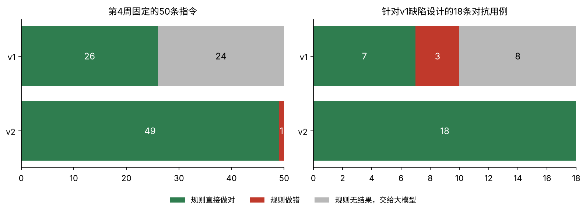
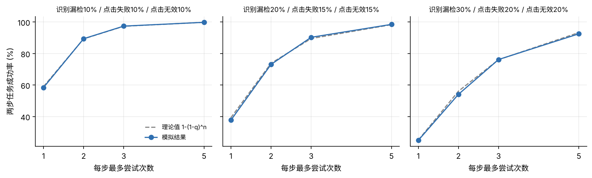

# 1. 本周做了什么

本周的目标有四项：复杂任务拆解、错误检测与重试、屏幕感知优化、状态监控与日志。对应的代码都放进了 v2.0，新增文件如下，整理工程时 v2 已经取代了原来的 `perceiver.py / controller.py / main.py`，文件名去掉了 `_v2` 后缀，下表按整理后的名字写。

| 目标 | 新增文件 | 主要内容 |
|---|---|---|
| 任务拆解 | `planner.py` | 按“然后/接着/再”等连接词拆分；识别“打开 X 搜索 Y”这种隐含的两步；规则拆不开的长指令可选交给大模型拆 |
| 错误检测与重试 | `executor.py`、`matcher.py` | 感知→决策→执行→验证的循环；失败原因分 11 类；退避重试；已试过的目标进黑名单；大模型调用加超时；任务总时间预算 |
| 感知优化 | `perceiver.py`、`controller.py` | DPI 坐标校正；大图先缩小再 OCR；画面指纹缓存；元素编号连续；中文输入走剪贴板 |
| 监控与日志 | `monitor.py`、`main.py` | 控制台 + 轮转文件日志；每次任务写一份结构化 `trace.jsonl`；任务结束输出汇总（步数、重试次数、各阶段耗时、失败原因分布） |

测试代码在 `tests/` 下：34 个单元测试、一套规则路由对比、20 个故障注入场景、一组随机故障模拟。

**先说明一个前提**：开发环境是 Linux 沙箱，没有 Windows 桌面、GPU、EasyOCR 和真实的 PyAutoGUI。因此所有测试用的是假的屏幕状态机和假的控制器，验证的是**逻辑是否正确**，而不是真机上的识别速度和点击成功率。真机上的感知速度表（第 4.3 节）需要在你的 Windows 电脑上跑 `scripts/bench_perception.py` 后填入，我没有编造这部分数字。

# 2. v1 里发现的问题

读 v1 代码并用测试验证后，列出对鲁棒性影响最大的几处。标“已测”的是在第 4 节里复现过的，标“读代码”的是只从代码推断、没有实机复现的。

1. **Tool Use 拦截太宽（已测）**。v1 用 `"chrome" in instruction` 判断是否启动应用，“搜索 chrome 教程”“搜索 Edge 怎么用”都会被当成“启动浏览器”。
2. **先点击后输入（已测）**。v1 对所有指令都先做点击匹配。屏幕上恰好有“天气 25°C”的小组件时，“搜索 天气”会被当成点击这个小组件。
3. **停用词直接替换（已测）**。`replace("the", "")` 会把 `Weather` 变成 `Weaer`，“点击 Weather”匹配不到，只能落到大模型。
4. **只返回一个结果（读代码）**。点了没反应时没有“换下一个候选”的办法。
5. **没有失败检测和重试（读代码）**。点击后不检查画面是否变化，大模型无输出或给了非法 ID 就直接放弃。大模型调用没有超时，Ollama 卡住时整个程序跟着卡住。
6. **`typewrite` 输不了中文（读代码）**。PyAutoGUI 的 `typewrite` 只能敲键盘上有的字符，“搜索 天气”这类指令的输入内容打不出去，而且函数仍然返回成功。
7. **没有处理 Windows 缩放（读代码）**。缩放 125%/150% 时，截图像素与鼠标坐标不是同一个坐标系，点击会整体偏移。
8. **整屏原分辨率 OCR（读代码）**。分辨率越高越慢；元素编号因为过滤低置信度而出现空洞。

# 3. v2.0 的设计

## 3.1 复杂任务拆解

`TaskPlanner.decompose()` 返回一组按顺序执行的单步指令。

- 连接词（然后、接着、随后、之后、并且、再、and then）后面必须紧跟动作动词才拆，所以“发送 我们再见”不会被拆开。
- “打开 Chrome 搜索 天气”这类没有连接词的指令，开头是打开类动词、后面又出现搜索/输入类动词时拆成两步。
- 不按逗号拆。第 4 周的“点击输入聊天信息框，打字说 下周赛道见”本来就是一步。
- 可选的大模型拆分（`--llm-plan`）：只在规则只拆出一步、指令又超过 30 个字时才调用；返回结果不是合格的字符串数组就退回规则结果。

## 3.2 错误检测与自动重试

单步的一次尝试是：系统 API 启动（可选）→ 感知 → 决策（规则优先，大模型兜底）→ 执行 → 验证。验证的办法是执行前后各取一张 64×36 的灰度小图（“指纹”），灰度差超过 6 的格子数达到 3 个就认为画面变了。这两个数怎么定的见 3.6。

失败被归成下面几类，重试时按原因处理：

| 失败原因 | 含义 | 重试时怎么做 |
|---|---|---|
| perception_error | 截图/OCR 抛异常 | 退避等待后重新扫描 |
| no_elements | 没识别出任何文字 | 同上（页面可能还在加载） |
| no_candidate | 规则没找到，也没有大模型 | 重试（识别结果可能变了），最终失败时给出此原因 |
| llm_no_output / llm_invalid / llm_timeout | 大模型无输出 / 给了不存在的 ID / 超过 60 秒 | 再问一次，已试过的元素从字典里去掉并在提示里告诉模型 |
| action_failed | 控制器返回 False（越界、异常） | 同一目标再试；连续失败两次就换目标 |
| no_screen_change | 点了画面没变 | 目标进黑名单，下次换下一个候选；候选用完后清空黑名单 |
| budget_exceeded / skipped | 超过任务时间预算 / 前一步失败后被跳过 | 不重试 |

默认每步最多 3 次，退避 0.5/1/2 秒；步骤失败后默认中止后续步骤（`on_step_fail="abort"`），也可以改成继续。`FailSafeException`（鼠标甩到屏幕角落）一路抛出，不会被当成普通失败重试，这点有专门的测试。

## 3.3 规则匹配的改进（`matcher.py`）

- 先判断“点击”还是“输入”，再决定匹配方式。
- 停用词分两档，英文按单词边界删除，所以 `Weather` 不会被破坏。
- 返回按分数排序的候选列表，重试时可以换下一个。
- 精确和包含匹配都失败时用 difflib 做模糊匹配，容忍个别 OCR 错字（要求关键词至少 4 个字符，相似度不低于 0.82）。
- 输入类指令用规则提取要输入的文字，并按“搜索框 / 聊天框 / 通用”给元素打分挑输入框。

## 3.4 感知与控制优化

- **DPI**：启动时设置进程 DPI 感知，并用 `pyautogui.size()` 与截图尺寸的比例把 OCR 坐标换算回鼠标坐标。
- **降采样**：长边超过 `max_side`（默认 1600）先缩小再 OCR，识别后把坐标放回原图。代价是小字会漏识，量化结果见 4.3：缩小之后界面字号低于约 13 像素，召回率开始明显下降，所以 2K/4K 屏或小字号时建议 `--max-side 0`。
- **缓存**：连续两次扫描画面指纹没变就复用上次结果；执行完点击/输入后调用 `invalidate()` 强制重新识别。
- **其他**：元素重新连续编号；GPU 自动检测；每次扫描记录分段耗时。
- **控制器**：中文输入走剪贴板粘贴（需要 `pip install pyperclip`，粘贴后把用户原来的剪贴板内容放回去）；没装 pyperclip 时返回 False 并写日志，而不是悄悄成功；点击移动时间从写死的 1 秒改成默认 0.3 秒。

## 3.5 监控与日志

- 控制台 INFO、`logs/agent.log` DEBUG（2MB 轮转，保留 3 份）。日志里不放 emoji，避免 Windows GBK 控制台报编码错误。
- `logs/trace.jsonl` 每行一个事件（task_start / step_start / attempt / step_end / task_end），带各阶段耗时，方便事后用脚本统计。
- 任务结束输出汇总：步数、尝试次数、重试次数、总耗时、各阶段耗时、失败原因分布。
- `--dry-run` 只打日志不动鼠标键盘，第一次在真机上运行建议先用它。

## 3.6 验证阈值是怎么选的

**先说一个我自己查出来的问题。** 最初的实现是“两张指纹的平均灰度差 > 0.01 就算画面变了”，0.01 是我凭感觉设的，没有量过。写这一节时我在合成屏幕上量了一遍，发现这个判据基本不能用：弹出菜单只占画面 4% 左右，平均差只有 0.001 量级，比阈值小一个数量级，会被判成“点了没反应”，然后进黑名单、换下一个目标重试。故障注入测试没有发现它，是因为测试里用的是假感知器，指纹由假屏幕状态直接给出，根本没经过这条判据。

**怎么量的**（`scripts/study_threshold.py`，结果在 `results/week6/threshold_study.json`）：画一张 1920×1080 的假桌面（渐变壁纸、浏览器窗口、搜索框、若干行文字），对它做两类改动，每种随机位置/内容重复 200 次，用 `ScreenPerceiver` 里同样的指纹函数比较前后：

- **噪声类**（点击后不应该算“变了”）：鼠标光标挪位置、输入光标闪烁、右下角时钟走一分钟。
- **变化类**（点击/输入真正起作用时会出现）：弹出菜单（260×300）、发出一条消息、弹对话框（500×300）、整页切换、在搜索框里打 16 / 8 / 4 个字符。

**两种判据的结果**：

| 改动 | 旧判据（平均差>0.01）判为“变了”的比例 | 变化的格子数 最小 / 中位 / 最大 | 新判据（格数≥3）判为“变了”的比例 |
|---|---|---|---|
| 光标挪动（噪声） | 0% | 0 / 2 / 2 | 0% |
| 输入光标闪烁（噪声） | 0% | 1 / 2 / 2 | 0% |
| 时钟走一分钟（噪声） | 0% | 0 / 0 / 0 | 0% |
| 弹出菜单 | **0%** | 21 / 31 / 85 | 100% |
| 发出一条消息 | **0%** | 14 / 14 / 27 | 100% |
| 弹对话框 | **0%** | 62 / 62 / 62 | 100% |
| 整页切换 | 100% | 1375 / 1566 / 1566 | 100% |
| 搜索框打 16 字符 | 0% | 9 / 11 / 13 | 100% |
| 搜索框打 8 字符 | 0% | 4 / 6 / 8 | 100% |
| 搜索框打 4 字符 | 0% | 2 / 3 / 4 | 72.5% |

**参数怎么挑的**：新判据有两个参数，格子的灰度差门槛 `cell_delta` 和需要变化的格数 `min_cells`。规则是：对每个 `cell_delta`（试了 6、12、24），先取噪声类里变化格数的最大值，`min_cells` 取它加 1，保证噪声类一次都不误触发；然后比较各组合在变化类上的检出率，选检出率最高的。结果是 `cell_delta=6` 时噪声最多 2 格，`min_cells=3`，除了“打 4 个字符”（72.5%）之外全部 100% 检出；`cell_delta=12` 时 8 字符只有 90%、4 字符只有 3%；`cell_delta=24` 时弹出菜单只有 34%，因为菜单和背景的对比度不高，格子平均下来不超过 24。

**这个选择的局限**：

1. 噪声类只有三种，而且都是合成的。`min_cells=3` 比噪声最大值只多 1 格，余量很小。真机上有视频、动图、滚动文字时噪声会更大，这时验证会误判为“有变化”（这是第 5 节局限 3 说的老问题，这里只是把它的程度量化了：静态噪声不会触发，动态内容会）。所以在真机上先运行 `python -m scripts.bench_perception --idle-check`，静止屏幕上相邻帧超过 `cell_delta` 的格子数应该明显小于 3，如果不是，就把 `min_cells` 调大。
2. 少于大约 8 个字符的输入，变化量和光标噪声在同一个量级，验证分辨不出来。不过输入类步骤默认会按回车，回车通常会触发跳转或发出消息，变化大得多，所以实际影响比这一行看起来小，但没有真机数据，这只是推断。
3. 灰度差只看亮度，背景色和文字色亮度接近时（比如灰底浅灰字）会低估变化。
4. 代价是“变化检出”和“误触发”的取舍：把 `min_cells` 调大，噪声余量更足，但小变化更容易漏掉。调这两个参数不需要改代码，构造 `ScreenPerceiver` 时传进去即可。

# 4. 鲁棒性测试

## 4.1 单元测试

`tests/test_units.py` 共 34 个测试，全部通过，覆盖：文本归一化与关键词分档、模糊匹配、意图判断、输入内容提取、第 4 周 50 条指令的动作类型与输入文本、拆解（包括不该拆的情况）、感知模块的降采样坐标还原 / DPI 换算 / 缓存命中与失效 / 画面变化判断、控制器（越界、中文剪贴板、缺 pyperclip、FailSafe 抛出、普通异常返回 False）、日志与 trace。

## 4.2 规则路由对比：v1 与 v2

这部分比较的是**只用规则、不调用大模型**时，两个版本对一条指令做出的决定。v1 的规则逻辑是按 `main.py` 原样复刻的（`tests/legacy_router.py`）。结果分三类：规则做对、规则做错、规则没结果（交给大模型，此时对错取决于大模型，不计入对或错）。



| 测试集 | 版本 | 规则做对 | 规则做错 | 交给大模型 |
|---|---|---|---|---|
| 第 4 周固定的 50 条 | v1 | 26 | 0 | 24 |
| 第 4 周固定的 50 条 | v2 | 49 | 1 | 0 |
| 对抗用例 18 条 | v1 | 7 | 3 | 8 |
| 对抗用例 18 条 | v2 | 18 | 0 | 0 |

需要注意三点：

1. **对抗用例是我在读完 v1 代码之后针对它的缺陷设计的**，所以 v2 在这一组上全对并不说明它在任何输入上都全对，只说明上面第 2 节列的问题确实被修了。真正没有“针对性”的是第一行那 50 条。
2. 第 4 周 50 条里 v2 唯一做错的是“在输入框打字”。屏幕上有搜索框和聊天框两个输入框，指令没有说是哪个，v2 选了搜索框，而标准答案是聊天框。我认为这条指令本身有歧义，没有为了凑数去调规则。
3. v1 的“交给大模型 24 条”在真实运行里最终对不对，取决于 llava 或第 5 周的 LoRA 模型。本报告不对这部分下结论。v2 把这 24 条里的大部分用规则直接处理了，好处是更快、更可预测，但也意味着规则出错时不会再有大模型兜底，这是个取舍。

规则路由里，“应用图标”类指令（Chrome、Edge）在 v2 里走的是系统命令启动，这一路径只在 Windows 上启用；评测里按“启动应用也算达成目的”处理。

## 4.3 降采样的代价

### 能量化的部分（`scripts/study_downscale.py`，结果在 `results/week6/downscale_cost.json`）

**1. 省多少算力（算出来的）。** 文字检测网络是全卷积的，耗时大致跟输入像素数成正比，缩放比例是 s = max_side / 长边，像素数变成原来的 s²：

| 屏幕 | max_side=1600 | 1280 | 1024 |
|---|---|---|---|
| 1920×1080 | 0.69 | 0.44 | 0.28 |
| 2560×1440 | 0.39 | 0.25 | 0.16 |
| 3840×2160 | 0.17 | 0.11 | 0.07 |

这是检测部分的理论比例。识别部分的耗时跟文字块数量有关，不受缩放影响，所以整体加速比会小于这张表。**真实的加速要用 EasyOCR 在真机上测**（见下面的真机部分），这里没有测。

**2. 缩放本身的耗时（实测）。** `cv2.resize`（INTER_AREA）在 1080p 到 4K 上是 1–24 毫秒，相对 OCR 的秒级耗时可以忽略。

**3. 坐标误差（算出来的 + 实测）。** 识别框是在缩小后的图上取整的，放回原图的量化误差最大是 0.5/s 个像素：1080p 缩到 1600 是 0.6 px，4K 缩到 1600 是 1.2 px，4K 缩到 1024 是 1.9 px，比按钮和文字的尺寸小得多。合成实验里，缩放前后文字框中心到真值的平均误差都在 0.4–1.9 px（召回接近 0 的格子没有统计意义，除外），没有随缩放系统性变大（不缩放时就有 1.2–1.9 px，来自 tesseract 的框和真值的差别）。所以降采样的代价不在“点偏”，在“漏识”。

**4. 漏识（实测，但用的是 tesseract 代理）。** 沙箱里没有 EasyOCR，我用 tesseract（中英文）做代理：用 Noto Sans CJK 在三种分辨率上渲染中英文界面词（每张约 250–1932 个目标），按 `max_side` 缩小后识别，命中的标准是目标位置上识别出的文字包含目标词。下表每格是“缩小后的字号 / 召回率”：

| 屏幕 | 原字号 | 不缩放 | max_side=1600 | 1280 | 1024 |
|---|---|---|---|---|---|
| 1920x1080 | 12px | 12px / 96.2% | 10px / 62.2% | 8px / 22.7% | 6.4px / 0.4% |
| 1920x1080 | 16px | 16px / 96% | 13.3px / 96% | 10.7px / 78% | 8.5px / 35.2% |
| 2560x1440 | 12px | 12px / 94.9% | 7.5px / 5.3% | 6px / 0.1% | 4.8px / 0% |
| 2560x1440 | 18px | 18px / 99.7% | 11.2px / 87.5% | 9px / 54.2% | 7.2px / 3.9% |
| 3840x2160 | 12px | 12px / 95.2% | 5px / 0% | 4px / 0% | 3.2px / 0% |
| 3840x2160 | 18px | 18px / 99.7% | 7.5px / 10.9% | 6px / 0.1% | 4.8px / 0% |
| 3840x2160 | 24px | 24px / 90.1% | 10px / 71.4% | 8px / 27.1% | 6.4px / 0% |

规律很清楚，召回率主要由**缩小后的字号**决定，跟原分辨率关系不大：缩后字号 ≥ 13 px 时召回 96% 以上，11 px 左右 78–88%，10 px 左右 62–71%，9 px 约 54%，8 px 约 23–27%，7.5 px 及以下基本在 11% 以下。

对默认值 `max_side=1600` 的含义：

- 1080p：16 px 字号几乎无损（96% → 96%），但 12 px 的默认界面字号从 96% 掉到 62%。
- 1440p / 4K：缩放比例 0.62 / 0.42，系统放大 150%（物理字号 18 px）也只剩 87.5% / 10.9%。
- 所以在 2K/4K 屏上，或者界面字小的时候，建议加 `--max-side 0`。代价是上表第一张里检测耗时的增加（4K 约 5.7 倍像素）。

**这个结论的可信度**：tesseract 对小字的鲁棒性一般比 EasyOCR 差（EasyOCR 先用 CRAFT 检测再识别），我预期 EasyOCR 的“悬崖”会出现在更小的字号上，所以上面的字号门槛应该读作**偏保守的参考**，不是 EasyOCR 的实测。表里 tesseract 的耗时我没有放进来，因为字号太小时它在垃圾区域上的耗时不能代表正常情况。

### 要在真机上补的部分

沙箱里没有 EasyOCR 和真实屏幕，所以 EasyOCR 的速度和召回率还没有。在 Windows 电脑上运行：

```
python -m scripts.bench_perception --repeat 5
```

它对当前屏幕分别用不缩放和 `max_side` 为 1600 / 1280 / 1024 扫描，并测一次“画面未变命中缓存”，输出平均耗时、元素数和相对不缩放的文字召回率，保存到 `results/perception_bench.json`。把结果填入下表：

| 配置 | 平均耗时 (s) | 元素数 | 相对不缩放的召回率 (%) |
|---|---|---|---|
| 不缩放 | （待测） | （待测） | 100 |
| max_side=1600 | （待测） | （待测） | （待测） |
| max_side=1280 | （待测） | （待测） | （待测） |
| max_side=1024 | （待测） | （待测） | （待测） |
| 1600 + 命中缓存 | （待测） | - | - |

拿到数字后，可以和上面的 tesseract 代理比较：如果 EasyOCR 的召回率在缩后字号 11 px 以上仍接近 100%，就说明代理偏保守，默认值可以放宽。

关于大纲里提到的 PaddleOCR：本周没有替换 OCR 引擎，仍用 EasyOCR，优化放在预处理（降采样、缓存）上。换引擎需要重新验证中文识别效果，所以只在此说明，没有实现。

## 4.4 故障注入场景

用一个假的“屏幕状态机”（桌面 → Chrome → 搜索结果等），在感知、控制器、大模型三处注入故障，检查执行器的行为是否符合设计。20 个场景全部通过。

| 场景 | 注入的故障 | 期望结果 | 实际 |
|---|---|---|---|
| S01 | 无 | 1 次尝试成功 | 通过 |
| S02 | 无（两步任务：点击后输入） | 拆成两步都成功 | 通过 |
| S03 | 无（“打开 X 搜索 Y”隐含两步） | 拆成两步都成功 | 通过 |
| S04 | 感知前 2 次抛异常 | 第 3 次成功 | 通过（3 次） |
| S05 | 感知一直异常 | 失败，原因 perception_error | 通过 |
| S06 | 目标文字第 1 次没识别出来 | 第 2 次成功 | 通过（2 次） |
| S07 | 前 2 次点击失败 | 第 3 次成功 | 通过（3 次） |
| S08 | 两个同名“关闭”，第一个点了没反应 | 第 2 次换目标成功 | 通过（2 次） |
| S09 | 目标坐标越界 | 失败，原因 action_failed | 通过 |
| S10 | 大模型先给不存在的 ID，再给正确 ID | 第 2 次成功 | 通过（2 次） |
| S11 | 大模型第 1 次超时 | 第 2 次成功 | 通过（2 次） |
| S12 | 大模型一直抛异常 | 失败，原因 llm_no_output | 通过 |
| S13 | 规则无候选且没有大模型 | 失败，原因 no_candidate | 通过 |
| S14 | 第 1 步失败，策略 abort | 第 2 步标记为 skipped | 通过 |
| S15 | 第 1 步失败，策略 continue | 第 2 步仍然执行并成功 | 通过 |
| S16 | 任务时间预算已用完 | 失败，原因 budget_exceeded | 通过 |
| S17 | 系统命令启动成功 | 走 tool_use，1 次尝试 | 通过 |
| S18 | 系统命令启动失败 | 降级走视觉路径成功 | 通过 |
| S19 | “搜索 chrome 教程” | 不能被当成启动 Chrome | 通过 |
| S20 | 控制器抛 FailSafeException | 任务立刻中断，不重试 | 通过 |

S19 里任务本身是失败的（假屏幕上没有搜索框），这是预期的；这个场景只检查“没有误启动应用”。每个场景的 trace 在 `results/week6/sample_logs/` 里。

## 4.5 随机故障模拟：重试到底有多大用

### 故障模型和公式

对两步任务（“点击 Google Chrome 然后 搜索 McMaster 选课”）随机注入三种故障，每次**尝试**都重新独立抽一次：

| 故障 | 符号 | 怎么注入 | 作用在哪 |
|---|---|---|---|
| 识别漏检 | p_m | 这次扫描里目标文字不出现 | 两步都有 |
| 点击失败 | p_f | 控制器返回 False | 两步都有 |
| 点击无效 | p_n | 点击成功但画面没变 | 只有第 1 步（第 2 步是输入，没有“点了没反应”这一类） |

设每步最多尝试 n 次（即 `max_retries`），一次尝试里各种故障互不影响，那么一次尝试成功的概率是：

- 第 1 步：q₁ = (1 − p_m)(1 − p_f)(1 − p_n)
- 第 2 步：q₂ = (1 − p_m)(1 − p_f)

一步在 n 次内成功的概率是 1 − (1 − q)ⁿ，所以

- **任务成功率** P = [1 − (1 − q₁)ⁿ] · [1 − (1 − q₂)ⁿ]
- **平均尝试次数**：一步最多尝试 n 次，期望尝试次数是 Σₖ₌₀ⁿ⁻¹ (1−q)ᵏ = [1 − (1−q)ⁿ] / q。第 2 步只有第 1 步成功才会执行，所以整个任务是 E = P₁/q₁ + P₁ · P₂/q₂，其中 Pᵢ = 1 − (1 − qᵢ)ⁿ。

例：p_m = p_f = p_n = 10%，n = 3。q₁ = 0.9³ = 0.729，q₂ = 0.81；P₁ = 1 − 0.271³ = 0.9801，P₂ = 1 − 0.19³ = 0.9931；P = 0.9801 × 0.9931 = 97.3%。E = 0.9801/0.729 + 0.9801 × 0.9931/0.81 = 1.344 + 1.202 = 2.55 次。

**模拟的设置**：每组 3000 次，随机数种子固定（`Random(1000·n + p_m·100)`），所以结果可复现；代码在 `tests/run_fault_injection.py` 的 `campaign()`。

**公式没有考虑的东西**：执行器里有“试过的目标进黑名单”“同一目标连续失败两次换目标”这些逻辑，公式把它们忽略了。模拟里目标只有一个候选，黑名单用完会清空，所以这些逻辑对结果没影响，这也是理论值能对上的前提。



### 结果

z 是（模拟成功率 − 理论值）/ 标准误，标准误 = √(P(1−P)/3000)，最大约 0.9 个百分点。

| p_m / p_f / p_n | n | 模拟成功率 | 理论成功率 | z | 模拟平均尝试 | 理论平均尝试 |
|---|---|---|---|---|---|---|
| 10% / 10% / 10% | 1 | 58.4% | 59.0% | -0.72 | 1.72 | 1.73 |
| 10% / 10% / 10% | 2 | 89.4% | 89.3% | +0.10 | 2.37 | 2.37 |
| 10% / 10% / 10% | 3 | 97.4% | 97.3% | +0.21 | 2.54 | 2.55 |
| 10% / 10% / 10% | 5 | 99.8% | 99.8% | -0.39 | 2.6 | 2.6 |
| 20% / 15% / 15% | 1 | 37.7% | 39.3% | -1.76 | 1.55 | 1.58 |
| 20% / 15% / 15% | 2 | 73.1% | 73.8% | -0.84 | 2.49 | 2.51 |
| 20% / 15% / 15% | 3 | 90.3% | 89.5% | +1.51 | 2.92 | 2.92 |
| 20% / 15% / 15% | 5 | 98.5% | 98.3% | +0.58 | 3.16 | 3.15 |
| 30% / 20% / 20% | 1 | 24.9% | 25.1% | -0.24 | 1.45 | 1.45 |
| 30% / 20% / 20% | 2 | 54.1% | 56.1% | -2.14 | 2.56 | 2.55 |
| 30% / 20% / 20% | 3 | 76.2% | 76.1% | +0.09 | 3.18 | 3.22 |
| 30% / 20% / 20% | 5 | 92.5% | 93.3% | -1.70 | 3.86 | 3.78 |

12 组里成功率最大偏差是 2.0 个百分点（30%/20%/20%、n=2：模拟 54.1%，理论 56.1%，z = −2.14），其余都在 1.6 个百分点以内、|z| < 1.8。12 组里有 1 组超过 2 倍标准误，纯随机下期望约 0.6 组，不算异常。平均尝试次数最大差 0.08（30%/20%/20%、n=5：3.86 对 3.78，约 2%），这个我没有查原因。整体上模拟和公式吻合，说明重试逻辑确实是“每次尝试独立重来”，没有出现重试之间互相拖累或卡死。

### 这张表能说明什么，不能说明什么

不能把它读成真机成功率：故障概率是我设的，而真实环境里的故障不独立，例如页面没加载完，连续几次都会识别不到，这时重试带来的提升会比公式小得多。它能说明的是：如果故障是偶发的，重试能把成功率提升到什么量级。以 20%/15%/15% 为例，n 从 1 到 3，成功率 39.3% → 89.5%，平均尝试次数 1.58 → 2.92；再到 n=5，成功率 98.3%，平均尝试 3.15，多出来的收益只有 8.8 个百分点，代价是最坏情况下多等两轮退避。所以默认取 3 次。

# 5. 局限

1. **没有真机测试**。感知速度、OCR 漏识率、真实的点击成功率都没有测。第一次运行请先用 `python main.py --dry-run`，确认日志里它“打算”点的位置合理，再去掉 `--dry-run`。
2. **验证只能证明“画面变了”，不能证明“变对了”**。点错了地方但画面也变了，执行器会认为成功。更可靠的验证（比如检查目标文字是否出现）留给后续。
3. **画面有动态内容时验证会失效**（视频、轮播、滚动字幕会让“没变化”的判断永远不成立）。3.6 里量过：静态噪声（光标、闪烁、时钟）不会触发，视频一类的动态内容会。目前没有做区域屏蔽。
4. **规则优先带来的风险**：规则命中但命中的是错的元素时，不会再有大模型复核。对抗用例是我自己设计的，不代表覆盖了真实世界的写法。
5. **任务拆解只是规则级别的**：它能处理“然后/再”这种显式顺序，对“把桌面上最大的文件发给张三”这类需要理解屏幕内容的任务无能为力。
6. **剪贴板输入依赖 pyperclip**，并且会短暂占用剪贴板。
7. **日志只写本机文件**，没有做远程监控；“实时监控”目前是控制台实时输出加 trace 事后分析。

# 6. 使用方法

```
pip install pyperclip                     # 输入中文需要
python main.py --dry-run               # 先试运行，不动鼠标键盘
python main.py                         # 正式运行（llava）
python main.py --agent lora --adapter D:\week5_lora   # 用第 5 周微调的模型
python main.py --retries 5 --llm-plan  # 更多重试 + 大模型辅助拆解
python -m scripts.bench_perception --repeat 5     # 补第 4.3 节的数据
```

在没有 Windows 的机器上复现测试（只需 numpy 和 opencv）：

```
python -m unittest discover -s tests -t .
python -m tests.run_routing_eval
python -m tests.run_fault_injection
```

# 附录：日志样例

下面是场景 S08（两个同名“关闭”，第一个点了没反应）和 S11（大模型超时一次）的日志片段，取自 `results/week6/sample_logs/agent.log`：

```
任务开始 '关闭'，拆成 1 步
步骤 1/1 开始: 关闭
  步骤 1 第 1 次尝试 失败 | 路由=rule 目标=21 原因=no_screen_change
  步骤 1 第 2 次尝试 成功 | 路由=rule 目标=23
步骤 1 完成（尝试 2 次）
任务成功 步骤 1/1，共尝试 2 次

任务开始 '点击 主页'，拆成 1 步
步骤 1/1 开始: 点击 主页
  步骤 1 第 1 次尝试 失败 | 路由=llm 目标=- 原因=llm_timeout (>0.2s)
  步骤 1 第 2 次尝试 成功 | 路由=llm 目标=31
任务成功 步骤 1/1，共尝试 2 次
```
