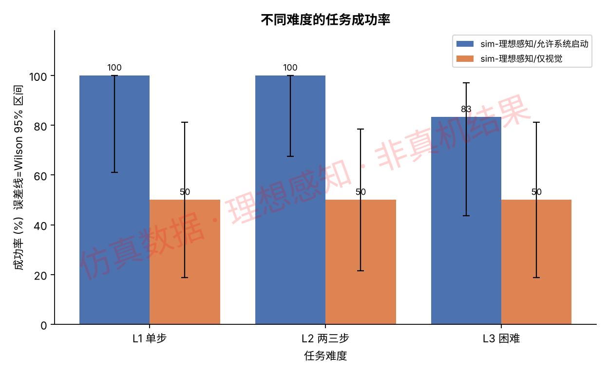
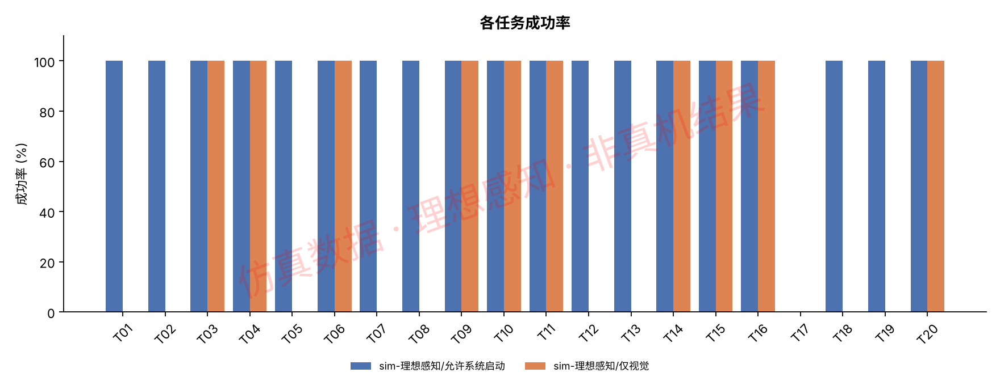
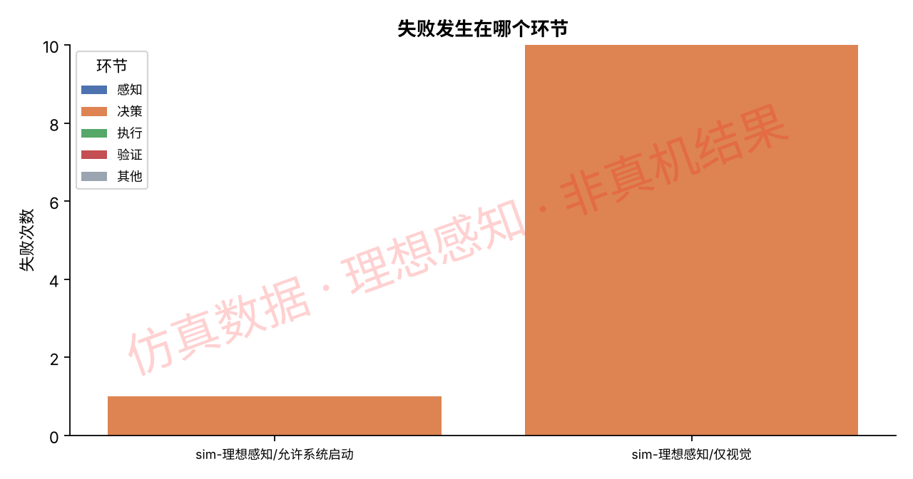
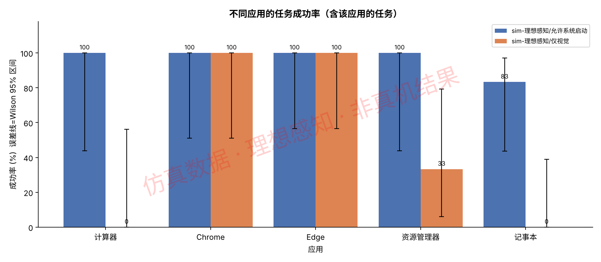

# 1. 摘要

本周的工作是对桌面 GUI 智能体做一次系统评估：设计 20 个难度不同的桌面任务，按成功率、平均执行时间和错误率三个指标评估，分析不同应用和分辨率下的差异，并和 UI-TARS、Claude Computer Use 对比。评估分两部分进行：一是在理想感知条件下的仿真评估，用来确定这套决策逻辑本身的上限；二是在 Windows 真机上的评估（3.3 节）。评估脚本、统计脚本和出图脚本都已写好，评估流程见第 5 节。

主要结论：

1. 理想感知（OCR 全部识别正确、点击不失败）下，允许系统命令启动应用时，20 个任务通过 19 个（95%）。唯一失败的是 T17“往记事本空白区输入”：空白编辑区没有文字，规则找不到输入框。
2. 只走视觉路径时通过 10 个（50%）。失败的 10 个任务里，除 T17 外其余 9 个都是因为桌面上没有对应应用的图标（记事本、计算器、资源管理器）。视觉路径能否完成任务取决于目标在不在屏幕上，这也是保留“系统命令启动”这条路径的原因。
3. 和 UI-TARS、Claude Computer Use 相比，差距主要在感知（本项目只识别文字，看不到图标和无文字控件）和决策（规则加小模型，没有逐步推理，也不能根据结果修正计划），见第 4 节。

# 2. 评估方法

## 2.1 测试集

共 20 个任务，分三档难度。任务、预期拆解步骤和成功判定定义在 `evaluation/tasks.py`。

| 档 | 任务数 | 特点 |
|---|---|---|
| L1 单步 | 6 | 一个动作：启动应用，或在已打开的窗口里点一个文字目标 |
| L2 两三步 | 8 | 两步串联：打开应用后点菜单、搜索、输入网址 |
| L3 困难 | 6 | 三步以上、跨应用，或包含系统目前做不到的情况 |

| 编号 | 难度 | 类别 | 指令 | 判定（最终画面里应出现） |
|---|---|---|---|---|
| T01 | L1 | 启动应用 | 打开记事本 | 记事本 / Notepad / 无标题 |
| T02 | L1 | 启动应用 | 打开计算器 | 计算器 / Calculator |
| T03 | L1 | 启动应用 | 打开 Chrome | Chrome / Google / 新标签页 |
| T04 | L1 | 启动应用 | 打开 Edge | Edge / 新建标签页 / Microsoft |
| T05 | L1 | 启动应用 | 打开文件资源管理器 | 主页 / 此电脑 / 快速访问 |
| T06 | L1 | 界面点击 | 点击 下载（资源管理器已打开） | 下载（人工确认） |
| T07 | L2 | 菜单操作 | 打开记事本 然后 点击 文件 | 另存为 / 新窗口 |
| T08 | L2 | 界面点击 | 打开文件资源管理器 然后 点击 文档 | 文档（人工确认） |
| T09 | L2 | 搜索输入 | 打开 Chrome 然后 搜索 McMaster 选课 | McMaster |
| T10 | L2 | 搜索输入 | 打开 Edge 然后 搜索 Python 教程 | Python |
| T11 | L2 | 网址输入 | 打开 Chrome 然后 输入网址 www.wikipedia.org | Wikipedia / 维基百科 |
| T12 | L2 | 菜单操作 | 打开记事本 然后 点击 编辑 | 撤消 / 剪切 |
| T13 | L2 | 菜单操作 | 打开记事本 然后 点击 查看 | 缩放 / 状态栏 / 自动换行 |
| T14 | L2 | 网址输入 | 打开 Edge 然后 输入网址 www.baidu.com | 百度 / baidu |
| T15 | L3 | 多步导航 | 打开 Chrome 然后 搜索 天气 然后 点击 图片 | 图片（人工确认） |
| T16 | L3 | 多步导航 | 打开 Edge 然后 搜索 天气 然后 点击 图片 | 图片（人工确认） |
| T17 | L3 | 文本输入 | 打开记事本 然后 输入 你好 | 你好 |
| T18 | L3 | 单字符目标 | 打开计算器 然后 点击 7 | 7（人工确认） |
| T19 | L3 | 多应用 | 打开记事本 然后 打开计算器 | 计算器（人工确认） |
| T20 | L3 | 容错 | 打开 Edge 浏览器 搜索 Edge 浏览器使用教程 | 使用教程 |

设计时考虑了以下几点：

- 应用选用 Windows 自带和常见的五个（记事本、计算器、资源管理器、Chrome、Edge），不依赖需要登录的服务，便于复现。
- L3 里有两个任务落在系统能力边界上。T17 的记事本空白编辑区没有任何文字，OCR 找不到输入框；T18 的目标是单个数字，OCR 对单字符识别不稳定。设置它们是为了量出边界在哪。
- T20 针对旧版的缺陷：输入内容里含“Edge”，旧版用 `"edge" in instruction` 拦截，会把整句当成启动指令。
- T06、T08、T15、T16、T18、T19 这 6 个任务用 OCR 自动判定不可靠（例如资源管理器侧边栏本来就一直有“下载”二字），在 `tasks.py` 中标为 `auto_reliable=False`，运行时由人工查看屏幕确认。

## 2.2 指标

| 指标 | 口径 |
|---|---|
| 任务成功率 | 最终判定完成的比例（有人工确认以人工为准，否则用 OCR 自动判定），附 Wilson 95% 置信区间 |
| 平均执行时间 | 执行器从接到指令到结束的耗时，只统计成功的任务；失败任务的时间多花在重试上，混入会失真 |
| 错误率 | 1 − 成功率；失败按环节分为感知 / 决策 / 执行 / 验证 / 其他 |
| 重试率 | 至少重试过一次的任务占比 |
| 误报 / 漏报 | 执行器报告成功但最终判定未完成为误报；执行器报告失败但实际完成为漏报 |

样本量较小（20 个任务，每个跑 3 轮共 60 次），成功率接近 0 或 100% 时正态近似会给出越界区间，所以用 Wilson 区间。

## 2.3 控制变量

评估中变化的因素有三个，其余保持不变：

- 条件：是否允许系统命令启动应用（`--no-launch`），以及决策模型（llava / lora / none）。
- 应用：每个任务涉及的应用单独记一列，分析时按应用拆开统计。
- 分辨率和缩放：修改系统显示设置后重新运行，用 `--resolution-label` 标注。

每个任务开始前先关闭上一轮留下的窗口并回到桌面，再准备起始状态，避免任务之间互相影响。

# 3. 结果

## 3.1 第 4 周的压测数据

第 4 周对 5 类基础任务各设计 10 条变体，共 50 条指令。用 Mock 大模型隔离后规则路由全部通过；换成本地 LLaVA 后，点击类任务（打开浏览器、打开文件、关闭应用）通过率 100%，打字类任务（搜索、发送消息）通过率 0%，当时记录的原因是模型幻觉。

这是决策层的测试：给定手写的元素字典，看模型是否选对元素，并没有真正操作屏幕，因此它说明打字类是薄弱环节，但不是端到端成功率。第 5 周的 LoRA 微调和第 6 周的规则输入框识别都针对这个问题，结果见各自的报告。

## 3.2 理想感知条件下的仿真评估

做法是把 20 个任务放进一个模拟的 Windows 桌面，用真实的 planner、matcher、executor 执行。模拟桌面各界面上的文字按 Win11 中文界面设定（`evaluation/sim.py`），OCR 视为全部识别正确，点击不会失败。因此这部分回答的问题是：感知完美时，这套逻辑能否完成任务。理想条件下做不成的任务，真机上一定做不成；理想条件下做得成的，真机上还会受 OCR 漏识、界面差异、点击偏移影响。下面的数字均为仿真结果，不是真机成功率。

| 条件 | 通过 | 成功率 | 95% 区间 |
|---|---|---|---|
| 允许系统命令启动应用 | 19 / 20 | 95% | 76.4% – 99.1% |
| 只走视觉路径 | 10 / 20 | 50% | 29.9% – 70.1% |

仿真是确定性的，没有重复运行，区间只反映把这 20 个任务看作一个样本的不确定性。



| 难度 | 允许系统启动 | 只走视觉 |
|---|---|---|
| L1 单步 | 6 / 6 | 3 / 6 |
| L2 两三步 | 8 / 8 | 4 / 8 |
| L3 困难 | 5 / 6 | 3 / 6 |



结果显示：

- 唯一的逻辑失败是 T17。记事本空白编辑区没有文字，`find_input_boxes` 没有候选，规则路径返回 `no_candidate`。有大模型兜底时可能做成，也可能选错元素，需要真机数据判断。
- T18 在仿真中通过，是因为假设计算器的数字按钮能被 OCR 识别。真机上单个数字识别很可能不稳，预期成绩会下降。
- 视觉路径的 10 个失败全部是 `no_candidate`，涉及记事本（6 个任务）、计算器（3 个）、资源管理器（2 个）。除 T17 外，其余 9 个不是匹配逻辑的问题，而是模拟桌面上没有这些应用的图标（只有回收站、Chrome、Edge）。真实桌面上有没有这些图标由桌面布局决定，所以这一档的真机结果与布局有关。
- 允许系统启动时，所有“打开应用”的步骤都走 `tool_use` 路径，不依赖屏幕上有无图标。





仿真无法反映的因素包括：OCR 的真实漏识率、界面文字与设定的差异、窗口弹出时机、点击坐标偏移、大模型的实际表现以及耗时。

## 3.3 真机评估结果

【待填：按第 5 节运行后，将 `analyze` 生成的数据填入下表，图使用 `results/week7/` 下的 fig1–fig6。】

| 条件 | 分辨率 | 通过 / 总次数 | 成功率 | 95% 区间 | 平均耗时(成功) | 重试率 |
|---|---|---|---|---|---|---|
| agent=llava，允许系统启动 | 【待填】 | | | | | |
| agent=llava，仅视觉 | 【待填】 | | | | | |
| agent=none，允许系统启动 | 【待填】 | | | | | |

运行前对各任务的风险预估如下，用于和实测结果对照：

| 任务 | 预期风险 | 理由 |
|---|---|---|
| T01–T05 | 低 | 走系统命令启动，不依赖 OCR；验证用画面指纹变化，窗口弹出慢时可能误判 |
| T06、T08 | 中 | 需要 OCR 识别侧边栏的“下载/文档”，Win11 资源管理器字体较小 |
| T07、T12、T13 | 中 | 记事本菜单栏文字少，OCR 对短中文词有时漏识；界面语言不是中文时找不到 |
| T09–T11、T14 | 中 | 依赖浏览器首页搜索框或地址栏里含“搜索/网址”字样；页面未加载完时 OCR 读不到 |
| T15、T16 | 中偏高 | 三步串联，前两步任何一步偏了后面都做不成；点“图片”要求结果页已加载完 |
| T17 | 高 | 仿真已证明规则路径做不了，只能依赖大模型兜底 |
| T18 | 高 | 单个数字的 OCR 不稳定 |
| T19 | 中 | 第二个应用会盖住第一个，自动判定只能确认计算器 |
| T20 | 中 | 输入内容含中文，要走剪贴板粘贴，需要安装 pyperclip |

## 3.4 不同分辨率下的表现

分辨率主要通过降采样影响结果：感知模块在 OCR 前把截图长边缩到 `max_side`（默认 1600）以内，识别后再把坐标换算回原图。分辨率越高，缩得越多，小字越容易漏识。第 6 周用合成屏幕和 tesseract 做了量化（见第 6 周报告 4.3 节）：召回率主要取决于缩小后的界面字号，字号不低于 13 px 时召回在 96% 以上，11 px 左右约 88%，10 px 左右约 62%，7.5 px 约 11%，5 px 以下几乎为零。把这条曲线对应到常见分辨率（界面字号按 100% 缩放 12 px、125% 缩放 15 px、150% 缩放 18 px 计）：

| 物理分辨率 | 系统缩放 | 界面字号 (px) | 缩放系数 | 缩放后字号 (px) | 召回率（tesseract 代理） |
|---|---|---|---|---|---|
| 1366×768 | 100% | 12 | 1.000 | 12.0 | 约 95%（未缩放，实测） |
| 1920×1080 | 100% | 12 | 0.833 | 10.0 | 62%（实测） |
| 1920×1080 | 125% | 15 | 0.833 | 12.5 | 约 88%–96%（由相邻点插值） |
| 2560×1440 | 150% | 18 | 0.625 | 11.2 | 87.5%（实测） |
| 3840×2160 | 100% | 12 | 0.417 | 5.0 | 0%（实测） |
| 3840×2160 | 150% | 18 | 0.417 | 7.5 | 10.9%（实测） |

这里的召回率来自 tesseract，不是本项目使用的 EasyOCR，绝对值只作参考；EasyOCR 的数据由 `scripts/bench_perception.py` 在真机上测得。从趋势看，4K 屏以及 1080p 默认字号这两种情形在默认 `max_side=1600` 下风险最大，对应的处理办法是 2K/4K 屏或字号较小时用 `--max-side 0`，评估时用 `--resolution-label` 区分各组设置。

另外，Windows 缩放比例也影响坐标：v1 没有开启 DPI 感知，截图像素和鼠标坐标不在同一个坐标系。v2 在启动时开启 DPI 感知并做坐标换算（换算本身有单元测试验证），真机上点击是否准确由评估数据确认。

【待填：各分辨率下的真机成功率（`fig4`）。】

## 3.5 不同应用的差异

仿真中各应用的差异只来自屏幕上有没有对应文字（见 3.2 的按应用统计图）。真机上还有以下因素，评估后可按应用分组验证：

- 界面技术栈不同：记事本、计算器、资源管理器是 Windows 自身控件，Chrome 和 Edge 的页面内容是网页渲染，字体和对比度差别较大。
- 纯图标控件：Win11 窗口右上角的最小化、最大化、关闭都是图标，没有文字，OCR 路径点不到。因此任务集里没有“关闭窗口”类任务，环境清理用命令完成。
- 深色模式、高对比度主题会改变 OCR 识别率。
- 浏览器首页的内容随地区、账号、时间变化（如新闻推荐），会引入干扰文字。

# 4. 与 UI-TARS、Claude Computer Use 的对比

## 4.1 技术路线

| 维度 | 本项目 | UI-TARS | Claude Computer Use |
|---|---|---|---|
| 整体思路 | 流水线：OCR 找文字，规则匹配，匹配不到才问大模型 | 端到端视觉语言模型，截图进、动作出 | 通用多模态大模型加 computer 工具，截图进、工具调用出 |
| 感知 | 只识别文字（EasyOCR），图标和无文字控件看不到 | 直接看像素，训练用了大规模 GUI 截图、元素描述、状态变化描述 | 直接看截图；大屏通常先缩小再输入模型，坐标换算回去 |
| 定位目标 | OCR 框中心点；大模型只负责从编号中选 | 模型直接输出坐标 | 模型直接输出坐标，可先放大看局部再点 |
| 决策 | 规则优先，llava 或 1.5B 的 LoRA 小模型兜底；每步一次决策 | 每步先写一段“思考”（任务分解、里程碑、反思）再出动作 | 通用大模型逐步推理，多轮循环直到不再调用工具 |
| 动作空间 | 点击（含双击）、输入文字 | 统一动作空间：点击、拖拽、滚动、输入，以及结束、求助等 | 点击（左/右/中/双击/三击）、拖拽、滚动、按键、按住按键、等待、放大 |
| 错误恢复 | 按失败原因重试；看画面有没有变化 | 训练时使用反思数据和错误纠正配对数据 | 靠模型每步看新截图自行判断，超时和点错后的处理由调用方实现 |
| 运行方式 | 完全本地、离线 | 开源权重（UI-TARS-1.5 为 Apache-2.0），可本地部署 | 云端 API，按量计费 |

UI-TARS 一栏依据其论文；Claude 的动作空间依据第三方整理的官方文档摘要，见来源。

## 4.2 公开的基准数据

下表是各方公开发布的数字。不同来源、不同版本的基准不能直接横向比较，本项目没有在这些基准上测试，本项目 20 个任务的成功率也不能与它们对比。

| 模型 | 基准 | 成绩 | 来源与说明 |
|---|---|---|---|
| UI-TARS-72B | OSWorld（50 步 / 15 步） | 24.6 / 22.7 | UI-TARS 论文；同表 Claude 为 22.0 / 14.9 |
| UI-TARS-72B / 7B | ScreenSpot | 88.4 / 89.5 | 同论文；Claude Computer Use 为 83.0 |
| UI-TARS-72B / 7B | ScreenSpot-Pro | 38.1 / 35.7 | 同论文；Claude Computer Use 为 17.1 |
| UI-TARS-1.5 | OSWorld（100 步） | 42.5 | 官方模型卡；同表 OpenAI CUA 36.4，Claude 3.7 28 |
| UI-TARS-1.5 | ScreenSpot-V2 / ScreenSpot-Pro | 94.2 / 61.6 | 官方模型卡；Claude 3.7 为 87.6 / 27.7 |
| UI-TARS-1.5-7B（开源） | OSWorld / ScreenSpot-Pro | 27.5 / 49.6 | 官方模型卡 |
| UI-TARS-2 | OSWorld / WindowsAgentArena / AndroidWorld | 47.5 / 50.6 / 73.3 | UI-TARS-2 论文摘要 |
| Claude Sonnet 4.5 | OSWorld-Verified | 61.4%（2025-09） | 第三方汇总，非 Anthropic 原文 |
| Claude Sonnet 4.6 | OSWorld-Verified | 72.5%（2026-02） | 同上 |
| Claude Opus 4.7 | OSWorld-Verified | 78.0%（2026-04） | 同上 |
| 人类 | OSWorld | 约 72.4% | 同上 |

OSWorld 与 OSWorld-Verified 是两个版本，后者修正了任务歧义和部分评分问题，两者不能直接比较；步数上限也不同（15、50、100 步）；有的数字是厂商自报，有的来自第三方汇总。Claude 一侧的数字来自第三方汇总，未核对原始发布页，仅作参考。

## 4.3 差距分析

感知。本项目只识别文字。Win11 的窗口关闭按钮、浏览器工具栏图标、没有文字的输入框（记事本空白区）都是盲区，仿真里的 T17 就是这个原因。UI-TARS 和 Claude 直接看像素，没有这个限制。在高分辨率专业软件界面的 ScreenSpot-Pro 上，UI-TARS 7B 为 35.7（1.5 版 7B 为 49.6），Claude Computer Use 当时为 17.1，可见大模型在小目标、高分辨率下定位也不容易；而本项目的降采样策略在 4K 屏上损失更大（见 3.4）。

决策。本项目大部分指令在规则里就能解决，没有推理过程。规则找不到目标时，llava 在第 4 周压测中打字类为 0%；第 5 周用合成数据微调了一个 1.5B 的纯文本模型，它不看截图。UI-TARS 每步先写“思考”，Claude 靠通用模型每步重新看屏幕判断。本项目的规划是静态的：指令开始时拆成固定的几步，中途界面与预期不符也不会修改计划。

动作空间。本项目只有点击和输入，没有滚动、拖拽、快捷键、等待，做不了“滚动到页面底部再点”“Ctrl+S 保存”这类任务。清理工程时把没人调用的滚动和拖拽函数删掉了，补充时需要连同决策输出格式一起扩展。

反思与纠错。本项目的重试是按失败原因换一个目标再试，验证只看画面是否变化，不判断变得对不对。点错了地方但画面也变了，执行器会判成功，评估里的“误报”指标就是衡量这一点。UI-TARS 的训练里专门有出错后纠正的数据。

数据与训练。本项目微调用了 2400 条合成样本，与真实屏幕分布有差距；UI-TARS 使用大规模真实轨迹，UI-TARS-2 还用了多轮强化学习和沙箱环境，数量级不可比。

评估规模。本项目是 20 个自设任务；OSWorld 有 369 个跨系统的真实任务，评估和判定更严格。

成本与隐私。本项目全部本地运行，不上传屏幕内容，没有 API 费用，规则路径也不需要调用大模型；代价是准确率上限较低。耗时对比需要真机数据（3.3 节）。

## 4.4 改进方向

按性价比从高到低：

1. 补一路控件检测，或换用能看图的 grounding 模型。UI-TARS-1.5-7B 为 Apache-2.0 开源，可作为规则找不到目标时的兜底，替换 llava，在同一套 20 个任务上对比（评估脚本已支持用 `--agent` 切换，只需写一个与 `GUIAgent` 接口一致的 `agent_uitars.py`，显存需求需先确认）。
2. 升级验证：点击后除了看画面是否变化，还检查目标文字或预期文字是否出现，降低误报。
3. 补充动作空间：优先加快捷键、滚动、等待，这三个在真实任务中最常用。
4. 动态重规划：每步执行后重新判断下一步是否仍然成立，而不是按固定计划执行到底。
5. 换用公开基准：用 OSWorld 或 WindowsAgentArena 中的少量 Windows 任务做对照，才能量化和它们的差距。

# 5. 评估流程

环境准备：安装依赖；使用 llava 时启动 Ollama。评估期间不要操作鼠标键盘，鼠标移到屏幕角落可紧急停止。

```
python scripts/check_env.py                                           # 检查环境
python -m evaluation.runner --agent llava --repeat 3 --resolution-label 1920x1080-125%
python -m evaluation.runner --agent llava --repeat 3 --no-launch \
        --resolution-label 1920x1080-125% --out results/eval_vision_only.csv
python -m evaluation.analyze --inputs results/eval_runs.csv results/eval_vision_only.csv --out results/week7
```

- `analyze` 生成 `results/week7/evaluation_results.xlsx`（原始记录，以及按任务、难度、应用、分辨率、条件、失败环节、失败原因的汇总）和 fig1–fig6 图。
- 对比分辨率：修改系统显示设置后换一个 `--resolution-label` 重新运行，多个 csv 可一起传给 `--inputs`。
- `--manual` 默认只对 6 个自动判定不可靠的任务暂停等待人工确认，全部人工确认用 `--manual all`。
- 中断后重新运行同一条命令，会跳过已记录的轮次。
- 仿真评估：`python -m evaluation.run_sim`，再用 `analyze` 出图（3.2 节的图由此生成）。

# 6. 局限

1. 仿真中的界面文字按设定编写，可能与实际 Windows 版本、语言、主题不一致；仿真假设 OCR 完美，上限偏乐观。
2. 20 个任务样本量小，每个任务重复 3 轮也只有 60 次运行，置信区间较宽，不宜对小差异下结论。
3. 自动判定依赖 OCR 关键词，6 个任务不可靠需要人工确认，人工确认带有主观性。
4. 任务集和难度分级由自己设计，带有主观性；T17、T18 是有意加入的边界任务，会拉低 L3 的成绩。
5. 与 UI-TARS、Claude 的对比只引用公开资料，Claude 一侧用的是第三方汇总，未核对原始发布页。
6. 3.4 节的召回率来自 tesseract 代理实验，不是 EasyOCR 的结果。

# 来源

- UI-TARS: Pioneering Automated GUI Interaction with Native Agents. arXiv:2501.12326. <https://arxiv.org/abs/2501.12326>
- UI-TARS-2 Technical Report: Advancing GUI Agent with Multi-Turn Reinforcement Learning. arXiv:2509.02544. <https://arxiv.org/abs/2509.02544>
- UI-TARS-1.5-7B 模型卡（Hugging Face，ByteDance-Seed 的镜像）. <https://huggingface.co/yugen0520/UI-TARS-1.5-7B>
- Claude 的 OSWorld 成绩与人类基线（第三方汇总）. <https://www.digitalapplied.com/blog/computer-use-agents-microsoft-anthropic-google>
- Claude computer use 工具的动作与分辨率说明（第三方整理）. <https://rkalani1.github.io/agent-builder-field-guide/browser-use/anthropic/>
